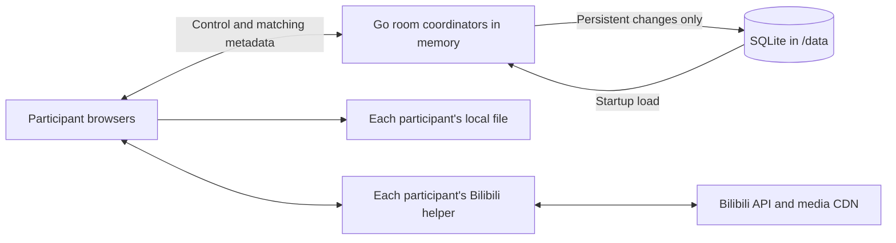

# Open Video Sync — Technical Design

## 1. Status, scope, and requirements

The [PRD](PRD.md) defines the product. This document defines the simplified target architecture approved on 2026-10-29.
[AGENTS.md](../AGENTS.md) defines development rules. [Version 2](wire-v2.md) defines the target application protocol.

The application implements identity, rooms, local synchronization, waiting policies, and Bilibili playback with danmaku.
Stage 4a / P8a implements application protocol v2, the memory-owned runtime, and the simplified persistent schema.
Stage 5 adds the deployment support in §12 and passes the release acceptance in §13. A successful hosted CI run is still required before a release claim.
The retained stage tracker records validation. Earlier stage evidence describes the previous behavior.

### 1.1 Core product

OVS is a private, self-hosted tool for watching together. A participant selects media, creates a room, shares an invitation, and plays with others.
Keep anonymous persistent identities, multiple private rooms, host permissions, basic waiting, local files, and Bilibili with danmaku.
Each participant obtains media independently. OVS carries control messages and bounded matching metadata only.

Use Go, Vue 3, TypeScript, Vite, Pinia, SQLite, and WebSocket. Embed the frontend in one application container.
Keep persistent application data in `/data`. Direct HTTP works; an optional external reverse proxy owns HTTPS.
Desktop Chromium and Firefox are required. Safari is outside the roadmap; mobile support requires separate evidence.

### 1.2 Scope limits

Do not add playlists, chat, public discovery, registered accounts, account recovery, federation, horizontal replicas, or media transfer.
Do not add backup/restore commands, post-restore invalidation, online backup, automatic database repair/recovery, operational metric services, or diagnostic playback telemetry.
Do not expose synchronization thresholds, late-join modes, per-member waiting exclusions, or retention tuning.
Invitation expiry, periodic playback checkpoints, and durable playback-command receipts are outside the target design.
YouTube and alternative transports are outside first-release work. Keep WebSocket without a separate transport research gate.

## 2. Architecture and ownership



An optional reverse proxy sits before Go. There is no server-to-platform media path and no participant-to-participant media path.

### 2.1 Backend ownership

Keep identity, rooms, transport, contracts, storage, and process composition in their existing packages.
Use small consumer-owned interfaces at actual I/O boundaries. Do not add generic caches, repositories, event buses, or empty architecture layers.

The process loads persistent identities, unexpired sessions, rooms, settings, memberships, invitations, and selected-media descriptors into memory before readiness.
The application owns that state for its lifetime. There is no database polling or read-through lookup on ordinary application requests.
Lists, snapshots, authorization, invitation lookup, and connected-session expiry checks read application memory.
Keep server-side expiry checks and immediate revocation; moving data into memory does not weaken authorization.

One coordinator serializes operations for each active room. Identity/session ownership has an explicit synchronized boundary.
Durable mutations commit before replacing the relevant memory state and publishing success. Publish the complete change without yielding to the next room operation.
Failed writes leave both authorization and room state unchanged. Coordinate identity revocation with socket closure before reporting success.
Do not hold a process-wide lock while waiting for SQLite. A room's management transaction may delay that room, not unrelated rooms.

Real-time commands, readiness, waiting timers, snapshots, heartbeats, and synchronization do not call storage.
Playback acknowledgement means the coordinator accepted and applied the command in memory. It does not promise survival across process restart.

Bound active rooms, connections, messages, and queues with internal defaults. Keep timer, goroutine, socket, and coordinator disposal explicit.
Inactive playback coordinators may be released. Their persistent metadata remains in application memory; reactivation starts paused at zero.

### 2.2 Frontend ownership

Vue renders views and dispatches user intent. Pinia holds sanitized room and identity state.
The synchronization engine owns clock estimation and drift correction. Adapters own video elements, files, object URLs, helper handles, and playback resources.
Do not put player instances, provider responses, files, timers, or signed URLs in serializable stores.
Cancel pending work on room, media, connection-owner, or adapter changes.

## 3. Trust boundaries and data ownership

| Data                                                          | Browser                                 | OVS memory / SQLite                                       |
| ------------------------------------------------------------- | --------------------------------------- | --------------------------------------------------------- |
| Local video bytes, filename, path, file handle, object URL    | Local player only                       | Never                                                     |
| Platform cookies and login tokens                             | Browser/manager session only            | Never                                                     |
| Signed media URLs and provider responses                      | Helper memory only                      | Never                                                     |
| Media bytes and danmaku payloads                              | Browser-local delivery and rendering    | Never                                                     |
| Local fingerprint, size, duration                             | Matching metadata                       | Memory; selected descriptor may persist                   |
| Bilibili BV ID, CID, part, duration                           | Matching metadata                       | Memory; selected descriptor may persist                   |
| Identity, display name, room settings and membership          | Authorized views                        | Persistent; also loaded in memory                         |
| OVS session bearer token                                      | HttpOnly cookie                         | Hash and session metadata only                            |
| Invitation link secret and code                               | Host sharing and participant redemption | Private persistent invitation record; host-only retrieval |
| Playback position, phase, waiting, presence, command receipts | Current room                            | Memory only                                               |
| Volume, mute, quality, danmaku preferences                    | Local preference                        | Never                                                     |

Invitation secrets are recoverable to support repeated sharing. Treat `/data` as private credential-bearing storage.
This does not change session-token storage: OVS session bearer tokens remain hash-only.
Use allowlisted DTOs. Never serialize arbitrary SDK objects, provider failures, or raw media inputs.

## 4. Anonymous identity, rooms, and invitations

### 4.1 Identity lifecycle

Bootstrap an identity automatically using a random 256-bit session token in a host-only HttpOnly `ovs_session` cookie.
Use `Path=/`, `SameSite=Lax`, and `Secure` only for configured HTTPS. Keep a rolling 365-day lifetime with renewal at most daily.
Load session hashes, expiry, identity, and CSRF metadata into memory. Check expiry there on every authenticated operation.
Create, renew, rename, and revoke through low-frequency persistent operations. Use exact-origin and session-bound CSRF checks for HTTP mutations.
Keep CSRF tokens in frontend memory. Never accept an identity ID as authentication.

Display names are optional, bounded to 48 Unicode scalar values and 192 UTF-8 bytes, and rendered as text.
There are no accounts, cross-device merging, or account recovery. Explain identity-loss consequences before forgetting a session.
Revocation immediately invalidates in-memory authorization and closes its sockets. Identity loss never transfers room ownership.

### 4.2 Room lifecycle

A persistent room contains its ID, title, host, two settings, membership, invitation, and optional selected media.
Rooms are private, with no public directory. Knowing a room ID does not authorize access.
The host selects media, changes settings, removes members, resets invitations, and closes the room. A non-host can leave.
Membership survives short disconnects and restart. Explicit final departure closes immediately; final connection loss starts a 30-second grace. Returning connections cancel closure. Restored empty rooms have 60 seconds to reconnect after startup. Visibility changes and atomic tab replacement are not departures.

A host may leave without closing for others. Persist Everyone controls before acknowledging host departure. Keep host membership for authorized return; do not elect a host or grant management rights. Keep Everyone on return until the host deliberately changes it. A disconnected host receives the same 30-second departure grace.

Automatic or explicit closure deletes persistent records before disposing runtime resources. Failed lifecycle writes leave memory unchanged, publish a safe error to remaining connections, and disable further automatic lifecycle writes until restart. Existing playback continues.
Bound stored rooms and membership with existing internal resource limits. Do not turn those limits into capacity promises or a retention feature.

### 4.3 Invitations

Keep a random 128-bit link secret and an independent 16-character Crockford Base32 code.
Use `/join#invite=<secret>`; remove the fragment before loading provider components, then redeem through a JSON body. Retain the validated pending secret in the current history entry across helper installation and reloads. Clear it when joining succeeds or the page leaves the join route. Do not put it in local storage or a shared frontend store.
Normalize only documented Crockford aliases, ASCII spaces, and hyphens. Do not use short numeric room IDs as secrets.

Invitations remain valid until the host explicitly resets them or the room closes. While the room remains open, failed joins, helper installation, reloads, departure, removal, and elapsed time never invalidate them. Ignore historical expiry metadata on legacy invitations. The host can retrieve the same invitation again without invalidating earlier shares.
Only the host may retrieve raw invitation values. Never include them in room snapshots, lists, logs, or other participants' responses.
Store the values in the private invitation record, with indexed hashes for redemption. Do not introduce encryption-key management for this purpose.

Joining persists membership once. Redeeming again as an existing member does not duplicate membership.
Removal atomically removes membership, then disconnects the removed member. Joining, leaving, removal, and sharing do not replace the invitation; only host rotation or room closure invalidates it. A removed participant can rejoin with the current invitation. Hosts can return through the room URL or redeem the current invitation without changing membership or losing management rights.
Return one safe error for unknown, revoked, or closed-room invitations. Rate-limit redemption in memory.

### 4.4 Connections and multiple tabs

Use one playback connection per identity per room. A new authenticated connection replaces the previous connection automatically.
The previous page pauses, disposes its player, and shows that the room is open elsewhere. It does not reconnect automatically after replacement.
Reloading that page can take ownership again. Do not add a lease-management control to the normal interface.
Server-side connection identity still rejects messages from replaced sockets. Different rooms remain independent.

A disconnected member has a fixed 15-second grace in an existing wait. Remove the member from that wait after the grace.
Host departure after its separate 30-second grace changes persisted `controllers` to Everyone, preserving playback. The 15-second waiting grace remains independent.
Never elect or transfer a host automatically.

## 5. Room state and policies

### 5.1 Runtime room

A room runtime owns its epoch, revision, media generation, playback timeline, connections, readiness, waiting state, and bounded recent command results.
These fields are memory-only. An epoch changes on process restart or coordinator recreation; revisions and media generations are scoped to that epoch.
Persistent settings and media are loaded into the runtime from application memory, not queried from SQLite per operation.

The server owns the timeline. Participant observations cannot replace it or grant authority.
Snapshots contain the caller's room-scoped membership, sanitized roster, media, settings, playback, and current wait.
A full snapshot is sufficient for reconnect. There is no persistent event log or replay history.

### 5.2 Settings

| Setting       | Values             | Default |
| ------------- | ------------------ | ------- |
| `controllers` | `host`, `everyone` | `host`  |
| `waitForAll`  | Boolean            | `true`  |

`waitForAll` covers startup and sustained buffering. Synchronization thresholds and timing constants are implementation defaults, not room preferences.
All participants use base rate 1.0; small temporary rate corrections are automatic. Volume, mute, fullscreen, quality, and danmaku remain local.

Changing media persists only the new descriptor, then resets runtime position to zero and pauses the room.
Changing `waitForAll` cancels an existing wait and pauses the room. Changing controller permissions preserves playback.

### 5.3 Playback and waiting

Use `empty`, `paused`, `waiting`, `playing`, and `ended` phases in memory.
Play starts immediately when waiting is off. Otherwise, wait for the active playback members to load matching media and permit playback.
Freeze the required members for each wait. Late joiners never enlarge an existing wait or interrupt playback merely by joining.
Ready late joiners catch up automatically and participate in subsequent buffering waits. There is no alternative late-join mode or per-member exclusion.

Keep fixed internal defaults: 30-second wait timeout, 750-ms sustained buffering before a room pause, and one second of stable readiness before resuming.
A timeout leaves the room paused and clears automatic resume. Any controller allowed by `controllers` can retry or pause.
Only the host changes settings or removes a member. Show who is blocking the wait without exposing policy machinery.

Use current media generation and wait ID to reject stale readiness. Never let an old load completion release a newer wait.
Manual pause cancels pending play intent. Seek during waiting changes the target and creates a new wait while preserving play intent.
An empty room pauses. Ended playback is derived from the server timeline; a single client's early ended event cannot end the room.

## 6. Synchronization model

### 6.1 Timeline and command ordering

Project playback from an in-memory position anchor and monotonic server time:

```text
playing: target(t) = clamp(position + (t - anchorTime), 0, duration)
otherwise: target(t) = position
```

Commands carry epoch, media generation, expected runtime revision, and command ID.
The room coordinator validates in-memory authorization and connection ownership, rejects stale intent, applies the command, then acknowledges and broadcasts.
Concurrent stale commands receive a fresh snapshot. Do not replay stale play or seek automatically.

Keep one pending command per page and preserve focused controls while awaiting its result.
Normal acknowledgement waits do not change the player layout or dim controls. Show an additional recovery overlay only when the matching result remains missing for more than three seconds.
Measure this interval from command dispatch to its matching result, independently of media loading, buffering, and readiness waits. A received result ends the interval even when media preparation continues.
The overlay never replaces the existing player status. Retrying uses the original command ID and input; a result, new epoch, terminal room connection, or page disposal clears the pending feedback.

Keep at most 256 recent accepted command results per active room for up to 60 seconds, in memory only.
Check current authorization before returning a duplicate result. Reject the same ID with changed input.
After eviction, expected revision prevents reapplying an accepted command; return stale state and reconcile instead of promising an old receipt.
A new epoch requires new user intent. Never persist command receipts or queue controls for offline replay.

### 6.2 Clock and drift correction

Use browser `performance.now()` and server monotonic time. Keep the existing four-timestamp clock exchange and bounded low-RTT sample window.
Reset estimates on reconnect, epoch change, and resume from suspension. Track uncertainty without claiming it bounds actual playback skew.
A client may show the room while calibrating, but reports loading until it has a usable clock estimate. While seeking, report buffering when playable data is missing; otherwise report loading. Neither status is ready, but buffering lets sustained seek delays trigger the room's buffering wait.
Sample player position locally every 250 ms while visible and playing. No diagnostic observation message goes to the server.

Use internal defaults: 100-ms soft drift, 750-ms hard drift, sustained-error filtering, and rate correction between 0.95 and 1.05 when supported.
Seek for large errors. Bound repeated corrective seeks and allow settling. Explicit user seeks apply immediately.
Suspend correction while buffering, seeking, missing media, or awaiting a browser gesture.
Degraded clock estimates disable small corrections while keeping explicit controls and safe reconciliation available.

### 6.3 Events and reconnect

Keep user intent separate from programmatic player events. Correlate asynchronous apply operations and cancel stale media work.
Send liveness/clock messages independently of SQLite. Pause locally after five seconds without server liveness; expire server connections after 15 seconds.
Reconnect with bounded exponential backoff, reauthenticate in memory, fetch a snapshot, recalibrate, and reconcile.
A replaced tab does not enter this reconnect loop.

After restart, persistent room metadata and selected media survive. Playback starts paused at zero with a new epoch and empty readiness.
Do not save playback position on a timer, control command, idle eviction, or shutdown. Local files still require browser reselection after reload.

## 7. Player adapter and local media

### 7.1 Adapter boundary

Keep the existing small load/play/pause/seek/position/events/dispose boundary.
Play, pause, seek, and position reporting are mandatory. Declare optional rate and buffering capabilities without a future-provider framework.
Use seek correction without rate control. If an actual adapter lacks buffering detection, explain that automatic buffering waits are unavailable for it.
Startup readiness still checks real playable state. Do not add admission exclusions or pretend an unobservable buffer state is ready.
Current local and Bilibili adapters use an OVS-owned video element; validate their actual behavior.

Handle browser autoplay denial with a local Enable playback action. Keep that participant unready until playback is permitted.
Cancel loads and remove listeners, source buffers, timers, object URLs, and helper handles on disposal.

### 7.2 Local files

Use a normal file input and an object URL. The server receives only `{kind, fingerprintVersion, digest, sizeBytes, durationMs}` and an optional user-entered label.
Do not share filenames automatically. Never upload files, thumbnails, samples, subtitles, paths, or handles.

Retain fingerprint version 1: up to three 1-MiB samples at the start, middle, and end; include room ID and size in the versioned SHA-256 encoding.
The existing worker and shared vectors define the exact byte encoding. Keep the incremental hash implementation for ordinary HTTP.
Match size and digest, with duration within 250 ms. This detects accidental differences; it is not proof of identical content or access rights.
Probe codec support using the actual player. Do not transcode or promise untested formats.

## 8. Bilibili integration and required proof of concept

### 8.1 Selected path

Retain the proven OVS-page-only Tampermonkey helper and OVS-owned player. Do not replace it with an iframe, platform tab, server resolver, or CORS proxy.
Each participant installs the helper and uses their own platform access. Ordinary on-demand AVC/AAC video, multipart selection, and text danmaku are the validated baseline.
Implement DASH AV1, HEVC, and AVC video with AAC audio. Require each exact codec string to pass the participant's MediaSource support check before selection. At the remembered playable quality or highest playable quality, prefer AV1, then HEVC (`hvc1` or `hev1`), then AVC (`avc1` or `avc3`). Share the video codec allowlist between helper selection and frontend metadata validation. Keep codec selection browser-local.
The earlier live baseline verifies AVC/AAC only. AV1 and HEVC require separate live-platform validation. Live streams, paid episodic formats, DRM, other codecs, and mobile remain unverified.

### 8.2 Helper scope and trust

Generate instance-specific rules from validated `OVS_PUBLIC_ORIGIN`. Check exact scheme, host, port, and top-level window at runtime.
During frontend development, Vite serves the local generated helper and matching release metadata for the explicit `http://127.0.0.1:5173` and `http://localhost:5173` origins. Scope each download to its exact development origin; map only those origins in the API and WebSocket proxies. Production distribution continues to use `OVS_PUBLIC_ORIGIN`.
Use narrow `@match`, `@noframes`, and reviewed `@connect` destinations. No arbitrary page-supplied URLs, headers, methods, cookies, or remote executable code.
The versioned helper has explicit missing/incompatible/permission/access errors. Distribute it with OVS and keep updates manual and reviewable.
Platform cookies stay with the browser/manager. Provider responses and signed URLs stay in helper memory.
The trusted OVS origin can invoke helper privileges; bridge nonces do not defend against malicious same-origin code. HTTP also trusts the network path.

### 8.3 Validation boundary

B0 established feasibility; Stage 4 integrated the production adapter. Preserve those records under `.misc/` with their original limits.
After P8a changes shared playback, recheck integrated playback, danmaku, cancellation, and independent sessions on Chromium and Firefox.
Do not rebuild the prototype or repeat unrelated provider experiments for every application change.
Routine tests use fixtures. Live checks have finite deadlines and retries; blocked provider access is unverified, not a pass.

#### 8.3.1 Accepted B0 baseline

Keep these selected interfaces and browser-local boundaries:

- Resolve BV/part/CID through `api.bilibili.com/x/web-interface/view`, tracks through `/x/player/playurl`, and danmaku through `/x/v2/dm/web/seg.so`.
- Use the participant's own available session. These observed interfaces are not a maintained public playback contract.
- Load AV1/HEVC/AVC video and AAC audio through DASH with SegmentBase/SIDX and MediaSource. Bound buffering, seek work, track appends, and eviction.
- Keep signed locations inside the helper; return opaque media handles and bounded byte ranges to the page.
- Check the helper release version, protocol, and build fingerprint before opening media. Generate the fingerprint from the bundled helper source and bridge parser. Probe legacy helpers without taking playback ownership so onboarding can request an update even when development builds share a release version. If the deployed build differs from the open frontend, request a page refresh first.
- On open, optionally return a browser-local playlist of up to 500 unique `{bvid,part,title}` entries and a title, derived from `pages` or `ugc_season.sections[].episodes`. Omit unsupported or oversized lists without blocking playback. Validate the bounded display metadata at the bridge boundary; never persist or broadcast playlists. The right sidebar offers Members/Episodes tabs, with the same tabs in the narrow-screen dialog. Mark the selected BV/part. Only the host selects an episode through the existing media replacement path; the room receives only the resolved selected-media descriptor and restarts paused at zero. Keep selection immediate and cancel stale adapter work.
- Permit only reviewed HTTPS API/CDN hosts and paths, including the selected `bilivideo.com` destinations and `upos-hz-mirrorakam.akamaized.net`. Reject unapproved redirects.
- Select the first permitted location from each DASH track's primary and backup URLs before requesting media. Skip unsupported locations without requesting them. If no location is permitted, report media-address incompatibility separately from network or helper-permission failures.
- Preserve existing request/response size, concurrency, deadline, and one-refresh bounds. Tune only when a real compatibility issue requires it.
- Keep no provider payloads or credentials in helper storage, frontend persistence, logs, SQLite, or room messages.

The recorded baseline used independent Chrome/Tampermonkey and Firefox/Tampermonkey profiles over HTTP, HTTPS, and insecure LAN HTTP.
It does not establish every browser, codec, access mode, or future platform version. Report tested versions and limitations when validating changes.

### 8.4 Playback and danmaku

The host supplies a canonical BV URL/ID and part. Each participant independently resolves the same `{bvid,cid,part,durationMs}`.
Require exact identifiers and duration within 250 ms. Access failure affects that participant only.
Media comes directly from the platform through the browser-local helper. Never download a whole video before playback or persist media.
Refresh expired locations locally with bounded retries and current-generation checks. Pin the existing video and audio quality IDs and exact codecs during refresh. Fail with media changed if either representation disappears; never append a different encoding using the existing byte index.
Browsers can defer opening a new MediaSource in a background tab. Count only visible time toward the source-open deadline, and continue initialization if the source opens while hidden. Preserve immediate cancellation and media-error handling. Keep helper request and SourceBuffer update deadlines unchanged.

Render bounded scrolling, top, and bottom text comments against observed video time. Follow pause, seek, rate correction, and part changes.
Reuse loaded comments and pending requests when a seek stays within the current six-minute comment segment, including position corrections after pausing. Rebuild visible comments at the observed time without clearing segment data. On a seek across segments, clear the previous segment and ignore its late replies. Keep explicit comment reload available.
Visibility, density, text size, and scrolling speed remain local to the room page. Display area is a browser-local preference that persists across reloads and rooms. Offer 0.5×–1.5× comment speed independently of shared playback speed.
Keep each visible comment in its assigned lane. Use measured text width, font-sized rows, and predicted exit positions to prevent overlap, including faster comments catching slower comments. Share occupied rows with pinned comments only after those rows clear. Offer full screen, the top half (default), or the top quarter of the player as the comment area. Limit only scrolling comments to the selected area. Fixed top and bottom comments use the full overlay, with their current positions and remaining lifetimes preserved when the area changes. Reserve the bottom controls area. Consume crowded timestamps once instead of displaying skipped comments late.
At 1×, every scrolling comment takes ten seconds from entry until its tail exits. Calculate velocity as `(viewport width + measured text width) / 10`, so longer comments move faster while sharing the same traversal time. Apply the local speed multiplier to velocity; an unchanged setting takes `10 / speed` seconds. Apply speed changes from the current position. Drive only transforms from observed media time, so pause and synchronization rate corrections also apply to comments. Pinned and reduced-motion comments remain stationary for six seconds. Rebuild layout after seeking, resizing, or changing text size, and dispose rendering with its adapter.
Ignore executable/advanced-script comments. No submission, server persistence, or relay.
Comment failure is distinct from playback failure and from hiding comments.

The helper returns playable quality IDs from the participant's DASH response and accepts a requested ID on `open`.
Show the loaded track's AV1, HEVC, or AVC codec beside the Bilibili source label. Derive the badge from browser-local adapter metadata, clear it during media replacement, and update it after quality changes. Keep the badge absent for local files and unknown metadata.
SIDX parsing accepts the full 31-bit direct-reference size without allocating a whole media fragment. Nested indexes and unsafe offsets remain invalid.
Read and append at most 256 KiB at a time. Keep one cursor and at most one pending chunk per track; alternate audio/video work within a bounded buffering pass.
Track completed fragments within each seek generation. Advance even when reordered frames need the next fragment to complete the reported buffered range. A later seek can download evicted fragments again.
Use the nearby SIDX byte rate to estimate a 32 MiB video / 4 MiB audio buffering budget. Keep 1–12 seconds ahead and bounded history; preserve the current fragment's keyframe during eviction. These estimates do not measure browser allocations.
On browser quota pressure, evict played data and retry the same chunk once. Retain that chunk while buffered playback can advance; fail if no playable headroom remains.
On seek, discard stale replies and reset incomplete MediaSource parsers before reading a new fragment. Browser codec and memory limits still apply.
Only returned tracks are offered. Quality switching opens a new local adapter, retains room playback intent, reports readiness, and converges to the current timeline.
Never claim a pending/failed quality is active. No adaptive Auto mode is implemented. Live quality switching requires evidence beyond the fixed-quality B0 baseline.
Root `versions.toml` is the sole module release-version source. The helper build generates `modules/helper/dist/release.json`; script identity is stable per instance. `probe` is non-owning and never cancels active helper work.

## 9. HTTP and WebSocket contracts

[Version 2](wire-v2.md) defines the implemented application contract. Helper protocol and local fingerprints retain version 1.
Version application routes and socket envelopes together; serve the matching frontend in the same binary.
Do not keep two room engines or silently interpret an old settings object as the new one.
An old client receives an upgrade error and reload guidance, not an automatic replay of old intent.

Keep session/profile, room creation/listing, invitation retrieval/reset/redemption, settings, removal/leave, closure, and the room socket.
Real-time socket messages cover controls, media selection, readiness, snapshots, command results, lifecycle, clock, and heartbeat.
Remove `member.observation`, `member.activate`, and `waiting.exclude`. Keep bounded strict decoding, safe errors, and connection sequence checks.

Keep short-lived HTTP retry results in bounded application memory. No HTTP idempotency table is required.
Existing-member redemption is naturally idempotent. On restart or an expired create receipt, GET the known random creation ID and require fresh intent if unavailable. Never retry creation blindly or rely on the removed personal list.
A reused in-memory request ID with changed input is rejected. Never promise recovery of a command outcome across restart.

## 10. SQLite persistence

### 10.1 Persistent data

| Record            | Persisted information                                    | Write trigger                           |
| ----------------- | -------------------------------------------------------- | --------------------------------------- |
| Schema migrations | Version and checksum                                     | Startup upgrade                         |
| Identities        | ID, optional display name                                | Create or rename                        |
| Sessions          | Token hash, identity, CSRF metadata, expiry              | Create, daily renewal if needed, revoke |
| Rooms             | ID, title, host, two settings                            | Create, change settings, close          |
| Members           | Room, identity, room-scoped member ID                    | Join, leave, remove                     |
| Invitations       | Current link/code values and indexed verification hashes | Create or explicit host reset           |
| Selected media    | Allowlisted local or Bilibili descriptor                 | Select or replace media                 |

SQLite is not a runtime state store, queue, authorization polling mechanism, or synchronization clock.
Do not persist playback checkpoints, command results, HTTP retry receipts, storage probes, connection state, runtime revisions, or media generations.
Do not write activity timestamps merely because someone watches, sends a heartbeat, or requests a snapshot.
Session expiry remains enforced; expired sessions may be removed on startup and low-frequency credential maintenance.
Only empty-room departure cleanup is automatic; do not add invitation/identity retention policies.

### 10.2 Reads, writes, and failure

Read persistent application state on startup. Keep all hot-path reads and writes in memory afterward.
Durable user actions use short transactions that update only the affected records. Never rewrite room members or invitations for a playback action.
Keep constraints and foreign keys. Serialize bounded persistent writes with the existing simple storage boundary; no new persistence scheduler is needed.
There is no periodic flush of runtime state and no write-behind durability promise.

A failed persistent operation reports failure and leaves memory unchanged. Existing playback and in-memory permissions remain usable.
Mark persistent writes unavailable after an operational database failure. Do not run write probes or automatic recovery transitions.
The operator fixes storage and restarts OVS. Startup must load valid state successfully before readiness.
A failed revocation must report failure; it must never appear successful while leaving a reusable durable credential.

### 10.3 Startup, restart, and migration

Acquire the data-directory lock before opening SQLite. Only one process owns a data directory.
Retain WAL, foreign keys, recorded migrations, checksum validation, and the existing durability settings for persistent transactions.
Do not edit applied migrations or reset the database to hide schema errors.

P8a adds a migration that preserves identity, session, room, host, membership, and selected-media data while removing obsolete runtime persistence.
Map old controller settings directly; map old `waitMode` to `waitForAll`. Other retired preferences do not survive as hidden behavior.
Handle legacy hash-only invitations explicitly in the implementation plan; do not invent or recover unknown secrets.
The upgrade intentionally drops playback progress and retry history. Restart always begins paused at zero.

### 10.4 Data directory

Keep `/data` across container replacement. If an operator copies data, stop OVS and copy the whole directory with ownership, modes, and SQLite sidecars.
Do not copy a live database file alone. Old copies represent old application state, including old credentials.
OVS supplies no backup/restore or invalidation CLI and no automated downgrade workflow. Use a binary compatible with the saved schema.

## 11. Security and resource limits

Enforce membership, host policy, current connection, epoch, media generation, and revision in the server's memory-owned state.
Use high-entropy credentials, HttpOnly cookies, exact Origin/Host checks, CSRF protection, safe text rendering, CSP, and bounded strict JSON decoding.
Do not expose platform credentials, invitation secrets, session tokens, or raw provider failures in logs or diagnostics.
Use the configured public origin for links, cookies, and helper scope. Trust forwarding headers only from explicitly configured proxy peers.

Keep existing internal bounds for frames, room members, sockets, queues, request rates, and slow-client deadlines.
Drop slow clients and resynchronize instead of blocking a room. Never silently drop command results.
No administrator-facing tuning dashboard or metrics endpoint is required.

## 12. User experience, packaging, and operations

The main journey is select media on home, create or automatically redeem an invitation, share, and watch.
Home has inline Bilibili/local selection and invitation input, with no room directory. Room management uses accessible dialogs. The dark player integrates seeking, replay, volume, mute, fullscreen, danmaku, and real playable quality selection. Do not expose playback speed.
Retain the creator's browser-local file through the in-app transition. Automatically load Bilibili on entry and media changes; local participants choose their own matching file. Helper onboarding uses a non-owning probe, a bottom toast, and a dismissible entry dialog. Installation offers Reload page because userscripts activate on document startup. Use the instance-bundled helper release metadata as the version source. Detect a changed deployed helper requirement before recommending installation. Show names, connection state, readiness, and available controls.
Video-surface clicks and Space/K use the same authorized shared playback commands. Listen for player shortcuts across the foreground OVS page without requiring player focus. Left/Right seeks; Up/Down changes volume in bounded 10% steps; M toggles mute, D toggles Bilibili danmaku, and F toggles fullscreen. Interactive inputs, menus, and dialogs retain native key behavior, including Space activation on their buttons. Outside these surfaces, prevent native Space activation and toggle playback without moving focus, including on ordinary page buttons and links; Enter keeps native button activation. Ignore composing, modified, or already handled shortcut events. Backgrounding does not pause playback or disable synchronization while the connection remains active. On return, request fresh clock samples without clearing a usable estimate or interrupting playback. Persist only validated volume, mute, quality, and danmaku display area values in browser-local storage, with unmuted 50% volume and half-screen danmaku as the defaults. Quality has a dedicated keyboard-accessible menu. The helper selects the remembered playable tier or the highest returned playable tier when absent/unavailable. Remove the player settings button. Hovering the danmaku toggle opens its density, text size, scrolling speed, display area, status, and reload panel. Keep click and D as visibility toggles. Down opens the panel and focuses its first slider; Escape restores focus to the toggle. Touch long press opens settings without toggling visibility; ordinary taps still toggle. Keep the panel open while moving into it or interacting with its controls, and close on outside input. Own and cancel hover/hold timers and listeners with the control component. Local videos show no danmaku or player settings control. Change video uses form submission for Enter confirmation, excluding composing Enter. Confirm room departure before mutation. The OVS logo is a native home link opening in a new tab. Cap room content at 1600px and further constrain desktop width to keep the player at 16:9 within its viewport-height limit. Account for sidebar visibility and page gutters; wrap room actions when needed. Preserve the mobile player minimum height and viewport-filling fullscreen behavior.
The host sees the two settings, sharing/reset, remove-member, and close-room actions. Keep engineering parameters out of the UI.
Use Vue I18n for English and Simplified Chinese across interface text, accessibility labels, page metadata, and safe public failures. Follow the first browser language by default: Chinese language tags select Simplified Chinese; other tags fall back to English. React to system language changes while following the system. Offer System, 简体中文, and English through Settings → Language. Persist only the allowlisted language preference in browser-local storage, independently of identity, rooms, and appearance. Blocked storage keeps in-page switching usable. Store message keys and named parameters for transient messages so existing notices change language immediately. Keep participant content and media metadata in their original language.
Show actionable errors such as Choose the same file, Enable playback, Waiting for a participant, and Platform access unavailable.
Keep keyboard operation, subtle color feedback for focused controls, text labels, responsive layouts, and reduced-motion support. Suppress focus outlines on all focus targets and focus-containing wrappers. Preserve actual focus and focus restoration; do not blur controls to remove focus styling. While playback commands await confirmation, keep buttons and seeking focused with guarded, aria-disabled controls instead of native disabling; repeat actions remain unavailable.
The top open dialog or menu owns keydown, keypress, and keyup events even when focus remains underneath. Preserve native editing, navigation, and activation inside the surface; consume Escape to dismiss only that surface and restore focus. Keep a closing key's repeats and release isolated after unmount or transfer to another overlay. Request fullscreen keyboard locking and Chromium's Escape-only keyboard lock when available, releasing owned locks on fullscreen exit and player disposal. With locking allowed, the first Escape dismisses the overlay while fullscreen remains active; the next Escape exits fullscreen even from a focused player input. Browser-owned exits remain possible when locking is denied or unavailable, including Chromium on ordinary HTTP; dismiss the top overlay when fullscreen exits rather than leaving it open. Do not require HTTPS or keyboard-lock permission for playback or fullscreen entry.
Quick actions open through Cmd/Ctrl + K or a header entry beside the brand. Match localized labels, English/Chinese aliases, and `/` commands entirely in browser memory. `$` and direct canonical Bilibili links/BV identifiers use the existing picker parser; pass only BV and part to the picker, then require the normal preview/confirmation flow. Never resolve provider data or publish media while searching. Offer only context-appropriate actions, retain disabled playback reasons, and reuse the existing player and room authorization paths. Keep search input focused while using arrows, ignore composing Enter events, close instantly, and restore focus before opening a destination. Do not persist search text or add a room directory.
Keep server status, settings, and user identity on the right of the header. The settings menu groups appearance, language, notifications, and About, with native outside-click and Escape dismissal, keyboard navigation, and focus restoration. About reads the uncached public `GET /api/v2/version` response (`sync`, `web`, `helper`, `commit`, `dirty`, `tag`). The service uses its linked build version; frontend and helper versions come from their embedded release metadata. Capture the full Git commit, dirty state (including untracked source files), and an exact current-commit tag during the frontend build and embed them in the application. Container builds receive the same snapshot from the source checkout. Runtime metadata never depends on Git or the deployment directory. About displays a 12-character commit with the full hash in its title, a dirty badge only for modified builds, and a tag only when present. Without Git metadata, use an empty commit/tag and `dirty: false`, and hide these rows. Never use the browser-installed helper version for About.
Appearance is browser-local: use a muted Slate blue default, selectable Soft iris, Graphite, Quiet teal, Sage green, Dusty rose, Warm amber, Ocean blue, and Soft clay accents, and manual light/dark modes with dark as the default. Ignore system theme changes; legacy system-mode preferences fall back to dark. Persist only the allowlisted mode and accent in local storage; storage failure leaves in-page switching usable. Apply saved appearance before the first styled paint with a same-origin, revalidated bootstrap. Keep the video surface dark in either mode. Dialog motion uses opacity and scale, with a brief opacity-only reduced-motion path; keyboard interaction stays immediate.

Application messages and helper reminders use dismissible fixed bottom toasts without changing layout height. Persist an allowlisted left/center/right position in browser-local storage, defaulting to right. Success messages expire after six seconds, pausing while hovered or focused. Errors and helper reminders remain until dismissed or resolved.

Build the frontend before Go embedding. Ship one non-root application container with writable `/data`, without Node or an external database.
Keep `OVS_LISTEN_ADDR`, `OVS_DATA_DIR`, `OVS_PUBLIC_ORIGIN`, and `OVS_LOG_LEVEL`; add optional trusted-proxy CIDRs (`OVS_TRUSTED_PROXIES`) only for proxy address handling.
Use internal room/socket limits. Do not expose retention, synchronization, or recovery settings.

Keep direct HTTP and concise host/container/existing Caddy examples. OVS does not manage certificates or alter an operator's proxy installation.
The deployment tooling may provision a separate Caddy container over SSH. It builds and transfers images locally, prepares Compose when absent, and keeps persistent volumes stable across single-instance replacements. Public IP HTTPS uses explicitly configured short-lived ACME certificates. Public TLS verification must not fall back to internal certificates. Existing proxy installations require explicit external mode and remain operator-owned. Failed preparation leaves the running application intact; startup failures preserve data without an automatic downgrade.
Use bounded shutdown to stop admission and close sockets, workers, and SQLite. There is no playback checkpoint to save.
Keep structured error logs and minimal liveness/readiness checks using in-memory startup, shutdown, and write-failure flags, without SQLite polling.
Readiness may report failed persistence without stopping an already running playback loop.
Do not add metric collection, backup operators, or automatic database repair.

## 13. Validation

Validate core behavior on desktop Chromium and Firefox, including one mixed-browser room and ordinary LAN HTTP.
Keep unit/integration coverage for authorization, stale commands, waiting, cancellation, isolation, migrations, and failed durable writes.
Verify actual player behavior in browsers: local selection, codecs, autoplay, play/pause/seek, buffering, reconnect, tab replacement, Bilibili, and danmaku.
Use a representative external HTTPS proxy journey and verify WebSocket reconnect. Reuse the same application checks across equivalent Caddy arrangements.

Prove the new persistence boundary after initialization: ordinary reads, playback controls, readiness, and timer ticks perform zero SQL operations.
Exercise real SQLite for durable changes and upgrades. After restart, identities/rooms/settings/members/media survive; position, waits, and receipts do not.
Test a failed settings/member transaction without corrupting memory, and verify existing playback can continue without database access.

Measure control-response latency separately from actual playback skew. Use existing decoded-frame observations and declare their uncertainty and limits.
Exercise representative cross-region latency, jitter, packet loss, asymmetric paths, and recovery. Record conditions and observed results.
There is no fixed 20-room capacity gate, mandatory physical-display lab, universal p95/p99 SLA, or statistical-significance gate for ordinary releases.
For a performance claim, compare repeated trials in a matched environment and state sample counts and limitations. Do not infer faster playback from fewer SQL calls alone.

Routine tests stay offline. Live Bilibili checks remain explicit and bounded; missing live validation remains unverified.
Follow the regression-first ladder in AGENTS.md. Keep relevant evidence under `.misc/` and do not claim hosted CI success from local checks.

## 14. Implementation sequence

Stages 0–4 and B0 retain their historical completion records. Stage 4a revised their obsolete policies and database behavior.

1. Stage 4a / P8a: update contracts, move runtime ownership to memory, migrate persistent data, simplify UI/policies, and validate affected completed work.
2. Stage 5 / P9: finish minimal deployment, proxy support, accessibility, packaging, and accurate usage documentation.
3. Stage 5 / P10: validate the resulting core product, actual synchronization, supported browsers, and live Bilibili behavior.

The retained `.misc/implementation-plan.md` and `.misc/implementation-stages.md` define execution details and status. All three steps are complete.
