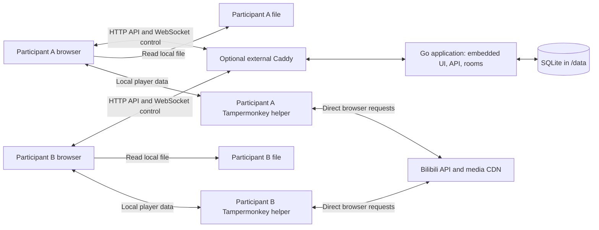
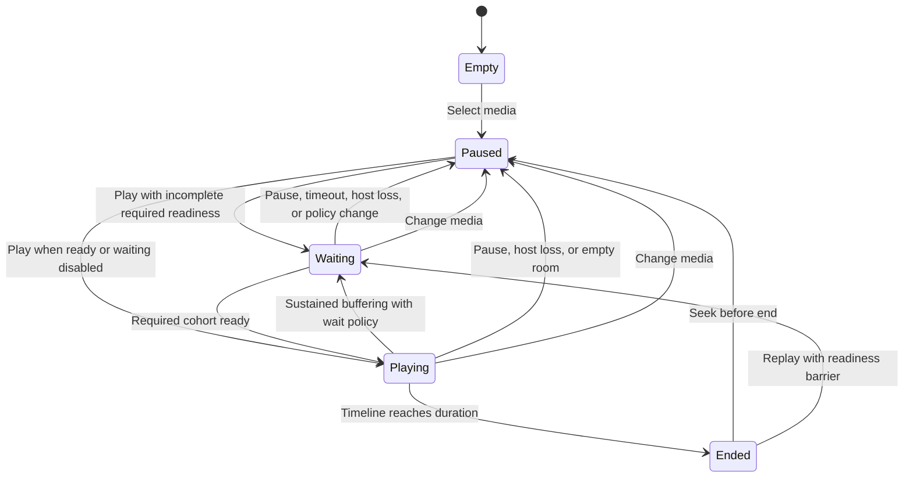

# Open Video Sync — Technical Design

## 1. Status, scope, and requirements

This document defines the proposed first-release architecture for Open Video Sync (OVS). The [PRD](PRD.md) is the product source of truth. [AGENTS.md](../AGENTS.md) defines development guidelines.

[Version-1 implementation contracts](wire-v1.md) define exact wire shapes, bounds, HTTP revision rules, request normalization, and ownership decisions from P0. Identity and room-management routes, full snapshots, local descriptors, and the authenticated room WebSocket protocol exist.

The repository implements process configuration and shutdown, health routing, embedded Vue/Pinia identity and room screens, SQLite ownership and migrations, anonymous sessions, private invitations and memberships, serialized room management, tooling, and container packaging. Local player adapters, sampled matching, clock estimation, playback correction, and transactional room controls are implemented as the P3–P5 development milestone. Complete waiting/buffering/late-join policies, retention cleanup, platform adapters, and automated recovery remain unimplemented. Unless explicitly identified as implemented behavior, the contracts, defaults, deployment examples, and performance targets below remain design decisions. Exact dependency versions belong in manifests and lockfiles. See [README](../README.md) for available commands and validation limits.

OVS is a private, self-hosted web application for synchronized viewing. Each participant obtains and plays their own media. The Go server coordinates rooms and playback; it never carries video content or platform credentials.

### 1.1 First-release scope

| PRD requirement | Design response | Acceptance evidence |
| --- | --- | --- |
| Independent self-hosting | One Go application container, embedded web UI, SQLite volume | Fresh deployment without a hosted OVS service |
| Control only | Typed control protocol; no media upload, download, proxy, or relay routes | Browser/server traffic inspection and rejection tests |
| Multiple rooms | Independent room coordinators, membership, policies, and timelines | Concurrent rooms with no cross-room events or permissions |
| Optional HTTPS | HTTP and WebSocket work directly; optional external Caddy | Direct HTTP, host Caddy, and container Caddy journeys |
| Anonymous persistent identity | Automatically issued OVS session cookie and persistent identity | Return visit retains identity without registration |
| Room sharing | Revocable invitation links and human-entered codes | Create, redeem, expire, rotate, and reject invalid invites |
| Host preferences | Server-enforced controller policy, drift correction, and waiting rules | Host and participant authorization scenarios |
| Browser player | Common adapter contract with explicit capability reporting | Real-browser local and platform adapter journeys |
| Synchronized playback | Server-owned timeline, clock estimation, reconciliation | Separate control-response and playback-skew measurements |
| Bilibili and danmaku | OVS player with an OVS-page-only Tampermonkey helper; subject to proof of concept | Passing Bilibili gate in section 8 |
| Local files | Browser file selection, local playback, metadata matching | Matching, mismatch, reselection, and unsupported-codec cases |
| Browser-only platform sessions | Platform login remains in platform/browser context | Synthetic credential-canary inspection at the OVS boundary |
| Existing access rights | Each participant resolves and plays media independently | Access failure affects that participant without credential sharing |
| Go, Vue 3, TypeScript, Vite, Pinia | Backend and frontend boundaries in section 2 | Build and embedded-asset smoke checks |
| SQLite and recorded DDL migrations | Ordered, checked migrations and bounded transactions | Upgrade, failed migration, and restore scenarios |
| Persistent `/data` | Mount the directory containing SQLite and its sidecars | Container replacement preserves application state |
| WebSocket first, measured across regions | Versioned protocol, bounded queues, impairment tests | Network matrix and transport decision in section 13 |

### 1.2 Scope limits and proposed defaults

The first release has one selected video per room. It does not include playlists, chat, uploads, transcoding, screen sharing, media caching, public room discovery, registered accounts, or federation. YouTube and alternative transports are later work.

The initial Bilibili validation target is ordinary on-demand video, including multipart selection and danmaku. Live streams, paid episodic formats, and other content classes need separate compatibility evidence before being advertised. This is a proposed support boundary to confirm through the proof of concept, not an exemption from the PRD's Bilibili requirement.

Run one OVS process per data directory. Horizontal replicas and a distributed coordinator are outside this release. Multiple independent installations may run with separate data directories and origins.

Numeric defaults are initial engineering choices. Change them with measured evidence and update the affected contracts. A failed Bilibili gate blocks declaring the PRD complete; a local-file-only build is an intermediate milestone.

## 2. Architecture and ownership



Browsers connect directly to Go when Caddy is absent. There is deliberately no server-to-platform media path and no browser-to-browser media path.

Each helper runs only on its participant's OVS page. Bilibili video and danmaku render in that page's OVS player; no Bilibili tab or iframe participates in playback. Tampermonkey is a participant-side dependency for Bilibili, not another application service.

### 2.1 Backend structure

Use domain-driven boundaries around identity and rooms. Keep domain rules independent of HTTP, WebSocket, SQLite, and browser implementations. Application services orchestrate transactions and adapters. Create layers only where code needs them.

| Proposed location | Responsibility |
| --- | --- |
| `cmd/ovs/` | Process composition, configuration, startup, shutdown, version output |
| `internal/identity/domain/` | Anonymous identity and session validity rules |
| `internal/identity/application/` | Session bootstrap, profile changes, identity reset |
| `internal/identity/infrastructure/` | SQLite identity/session persistence |
| `internal/rooms/domain/` | Membership, host authority, media descriptors, policies, timeline transitions |
| `internal/rooms/application/` | Room coordinators, command ordering, readiness, persistence orchestration |
| `internal/rooms/infrastructure/` | Room and invitation persistence |
| `internal/transport/http/` | HTTP routing, session middleware, strict decoding, safe errors |
| `internal/transport/ws/` | WebSocket lifecycle, framing, heartbeat, per-connection queues |
| `internal/contracts/` | Versioned wire types and validation; no business authorization |
| `internal/storage/` | SQLite connection setup, migration runner, transaction support |
| `internal/web/` | Embedded frontend assets and SPA serving |
| `migrations/` | Ordered SQL migrations and migration manifest/checksums |
| `web/` | Vue application, adapter implementations, frontend tests |
| `tests/e2e/`, `tests/network/` | Browser journeys and network impairment harness |
| `scripts/`, `deploy/` | Build automation and deployment examples |

One room coordinator serializes all mutations for its room, including HTTP management requests and WebSocket commands. A registry creates coordinators once and removes them after the last connection leaves and state is saved. An empty room is saved paused before eviction. Activation creates a fresh room epoch.

Room coordinators use bounded input queues. SQLite has one bounded write queue shared across rooms; transactions remain short. A slow write blocks publication of that room's proposed mutation, not socket reads or unrelated room computation. Queue saturation returns a retryable error instead of creating unbounded goroutines.

Interfaces belong at real seams: clock, random source, repository/transaction boundary, and connection sink. Do not introduce generic repositories, an event bus, or a plugin runtime for hypothetical future sources.

### 2.2 Frontend structure

Use Vue 3 single-file components with Composition API and `<script setup lang="ts">`. Vite builds static assets; Pinia holds shared application state.

| Proposed location | Responsibility |
| --- | --- |
| `web/src/features/identity/` | Bootstrap, optional display name, identity reset |
| `web/src/features/rooms/` | Create/join, roster, host controls, invitation management |
| `web/src/features/player/` | Player shell, media selection, readiness and error presentation |
| `web/src/player/adapters/` | Local-file and validated Bilibili adapters |
| `web/src/player/bilibili/` | Typed helper bridge, media loader, danmaku decoding/rendering |
| `userscripts/` | Proposed Bilibili helper source and instance-scoped distribution template |
| `web/src/sync/` | Clock estimator, timeline projection, drift controller, event suppression |
| `web/src/transport/` | HTTP client, WebSocket state machine, wire decoding |
| `web/src/stores/` | Identity, authoritative room snapshot, connection status, local preferences |

Pinia stores sanitized descriptors and UI state. Keep `File` objects, object URLs, player instances, platform responses, timers, and credentials out of persisted stores and debug exports. Adapter instances own those runtime resources and dispose them on room/media changes.

The client sync engine runs outside Vue components. Components dispatch user intent; the engine applies accepted room state to the active adapter. This separates rendering from timing and makes deterministic tests possible.

## 3. Trust boundaries and data ownership

| Data | Browser | OVS server memory/SQLite | Other room participants |
| --- | --- | --- | --- |
| Local video bytes and file path | Local file/player only | Never | Never |
| Platform cookies and login tokens | Browser/extension-managed platform session only; no export to page code | Never | Never |
| Signed playback URLs | Helper runtime memory only | Never | Never |
| Platform media bytes and danmaku payloads | Loaded directly from platform | Never | Never through OVS |
| Bilibili stable video/part identifiers | Yes | Current descriptor | Yes |
| Local sampled fingerprint, size, duration | Yes | Current descriptor and readiness metadata | Yes, within room |
| Display name and generated identity ID | Yes | Yes | Display name and room-scoped member ID |
| OVS session bearer token | HttpOnly cookie | Hash only | Never |
| Invitation secret | Creator/redeemer briefly | Hash only | Only through deliberate sharing |
| Playback state and sanitized readiness | Yes | Snapshot; live telemetry stays in memory | Yes, within room |
| Volume, mute, danmaku style, quality selection | Local preference | No | No |

OVS identity credentials are distinct from video-platform credentials. The server needs the former to preserve room ownership. The server must never receive the latter, including in error messages, telemetry, copied URLs, or debug bundles.

Use allowlisted wire fields rather than removing known secret names from arbitrary objects. Do not serialize player SDK objects. Do not implement a generic URL fetcher, CORS bypass, media proxy, cookie-import form, or platform-login callback on the OVS server.

## 4. Anonymous identity, rooms, and invitations

### 4.1 Identity lifecycle

1. The page calls `POST /api/v1/session` automatically on first use.
2. A valid cookie resumes the existing identity. Otherwise, the server generates an identity ID and a 256-bit random session token.
3. Store a SHA-256 hash of that high-entropy token, the identity ID, and expiry in SQLite. Return the raw token only as an HttpOnly cookie.
4. Use a host-only cookie named `ovs_session`, `Path=/`, `SameSite=Lax`, and a rolling 365-day maximum age. Set `Secure` for the configured HTTPS public origin.
5. Return the public identity profile and a session-bound CSRF token in the JSON response. Keep the CSRF token in browser memory.

Renew expiry at most once per day to avoid a write on every request. The server enforces expiry even if a browser retains a cookie. Never accept an identity ID supplied by the client as authentication.

Display names are optional, at most 48 Unicode code points and 192 UTF-8 bytes. Render them as text. A generated guest label is the fallback. Names need not be unique and do not confer host authority.

Identity continuity is per browser profile and OVS origin. Clearing cookies, private browsing, expiry, or switching devices may create a new identity. There is no account recovery or cross-device identity merge in the first release. Warn before “Forget this identity”: revoke the session, close its sockets, and explain that owned rooms may become inaccessible. Losing a host identity does not transfer ownership to another guest.

Cookie attributes and browser expiry behavior follow the browser's cookie implementation; `Secure` cannot be required for ordinary HTTP deployments. See [MDN Set-Cookie](https://developer.mozilla.org/en-US/docs/Web/HTTP/Reference/Headers/Set-Cookie).

### 4.2 Room lifecycle

A room has an opaque random ID, title, host identity, settings, current media descriptor, and checkpoint. Creation adds the creator as host and creates the initial invitation atomically.

Rooms are private capabilities, with no public listing. An authenticated user can list their owned/joined rooms. Knowing a room ID does not grant membership. Access checks bind every request and connection to its room.

The host can change settings, choose media, rotate invitations, remove participants, and close the room. Media selection is host-only in the first release. Playback control can be host-only or shared with current participants.

Membership persists across ordinary disconnects. A removed participant loses membership and all sockets immediately. Removal also rotates the invitation so the old code cannot immediately readmit that identity. It cannot stop a person receiving a new invitation under a new anonymous identity.

Room closure invalidates invitations, removes memberships, stops its coordinator, and deletes its current media/checkpoint records. Connected clients receive `room.closed`. Default expiry is 30 days without an authenticated room visit; cleanup only expires rooms with no active connections. Limits and retention are operator-configurable.

### 4.3 Invitations

Generate 128-bit random link secrets. The link form is `/join#invite=<secret>`. The frontend reads and removes the fragment with `history.replaceState`, then submits the secret in a JSON request body. Never put it in query parameters or access logs.

Also issue an independently random 16-character Crockford Base32 code, displayed in groups of four. This gives 80 bits before formatting. Codes are case-insensitive; normalize only the documented Crockford aliases and separators. Do not use short numeric room IDs as secrets.

Store hashes of both secrets. Both resolve to one invitation generation, expire after seven days by default, and rotate together. Return raw secrets only when creating/rotating an invitation; later requests create replacements rather than recovering stored secrets.

Redeeming an invitation atomically checks expiry, room state, capacity, and rate limits before creating membership. Repeated redemption by an existing member succeeds without duplicating membership. Return the same public error for unknown, expired, revoked, and closed-room invitations.

### 4.4 Presence and multiple tabs

Identity, membership, and connection are separate concepts. Each room membership has a room-scoped member ID. Each socket has a random connection ID and connection generation.

Only one connection per member per room may be the active playback connection. The first connection receives the lease when no live lease exists. Other tabs show an inactive-player state. “Use this tab” explicitly transfers the playback lease and pauses the previous tab. Readiness counts active playback connections, not tabs. The same identity may participate independently in different rooms.

A disconnected playback lease has a 15-second reconnect grace. Reconnecting with the same authenticated membership replaces the stale connection. A stale socket cannot submit commands or readiness after replacement.

If the host disconnects, preserve host ownership. After 15 seconds without a host playback connection, pause the room and clear pending play intent. Do not elect a new host. A returning host must explicitly resume. Non-host controllers may act during the grace period when shared controls are enabled; after host loss, only the returning host can restart playback. That explicit resume clears the host-loss restriction and restores the configured controller policy.

## 5. Room state and policies

### 5.1 Authoritative snapshot

| Field | Meaning |
| --- | --- |
| `roomId` | Stable room identity |
| `epoch` | Random coordinator incarnation; changes on activation/restart |
| `revision` | Durable, increasing room mutation counter |
| `mediaGeneration` | Increases when the selected media changes, even to the same video |
| `hostMemberId` | Host's room-scoped member ID |
| `selfMemberId` | Authenticated caller's room-scoped member ID; permits self-leave without exposing identity IDs |
| `settings` | Permission, synchronization, and waiting policy |
| `media` | Validated local or Bilibili descriptor, or absent |
| `playback` | Phase, position anchor, server time anchor, base rate, desired playback |
| `barrier` | Readiness barrier ID, required members, reason, deadline, if present |
| `members` | Bounded roster with roles, presence, and sanitized readiness |
| `serverNowMs` | Server monotonic time in this process's clock domain |

Use integer milliseconds on the wire. Reject nonfinite, negative, or out-of-range numeric fields and integer values outside JavaScript's safe range. Internal arithmetic may use finer precision. Wall-clock timestamps are reserved for expiry and audit metadata.

Each roster entry distinguishes `playbackActive` (the member has a connected playback lease) from `playbackEligible` (the member belongs to the current playback cohort). An active late joiner can remain ineligible under `wait_at_next_play` or an incompatible buffering capability. Clients apply a playing timeline only when eligible. `excludedFromWaiting` removes waiting responsibility without removing playback eligibility.

The server owns the intended timeline. Participant observations never replace it directly. A participant cannot become host by claiming a role or reporting a position.

### 5.2 Proposed settings

| Setting | Values | Default and behavior |
| --- | --- | --- |
| `controllers` | `host`, `everyone` | `host`; applies to play, pause, seek |
| `syncMode` | `seek`, `adaptive` | `adaptive`; use rate correction only when supported |
| `waitMode` | `none`, `all` | `all`; wait for the selected playback cohort |
| `waitOnBuffering` | Boolean | `true`; applies only with `waitMode=all` |
| `waitTimeoutMs` | 5,000–120,000 | 30,000; timeout keeps room paused for host action |
| `lateJoin` | `catch_up`, `wait_at_next_play` | `catch_up`; never interrupt current playback merely for joining |
| `softDriftMs` | 50–500 | 100; begin correction after sustained error |
| `hardDriftMs` | 250–2,000 and greater than soft threshold | 750; seek when exceeded |

The base playback rate is 1.0 in the first release. Temporary adapter rate changes correct drift; they are not shared user speed controls. Volume, mute, fullscreen, quality, captions where supported, and danmaku display remain participant-local.

Changing media pauses the room, increments `mediaGeneration`, cancels readiness barriers and pending adapter work, and resets position to zero. A settings change is revisioned; a change to waiting rules cancels its barrier and leaves the room paused. Other settings changes retain playback.

### 5.3 State machine



An adapter failure is participant-local readiness, not an authoritative room phase. Seeking while playing rebases the playing timeline. Seeking while paused remains paused. Seeking during waiting updates the target, replaces the barrier, and preserves play intent. Replay starts from zero. The server's duration timer moves the timeline to ended; one client's early `ended` event cannot end the room.

### 5.4 Readiness and waiting

Report one of `no_media`, `loading`, `ready`, `buffering`, `gesture_required`, `mismatch`, `access_denied`, `unsupported`, or `error`. Include media generation, barrier ID when applicable, adapter capabilities, sample time, and bounded position/duration metadata. Do not include platform errors verbatim.

On play with `waitMode=all`, freeze the required cohort from active, non-excluded playback members. Include the host. Each must confirm the current media generation, matching media, and a playable position within the target tolerance. A report from an older generation or barrier cannot release it.

Late joiners do not enlarge an existing barrier. Under `catch_up`, they load and join the current timeline when ready. Under `wait_at_next_play`, they remain paused until the next explicit play. After a catch-up participant is ready, include that participant in future buffering barriers.

If buffering persists for 750 ms, pause at the authoritative timeline position and create a barrier for the current playback cohort. Short buffer events do not pause everyone. Preserve desired playback while waiting so recovery can resume automatically. A manual pause always clears that intent.

Disconnected required members remain in the barrier for the 15-second grace, then are excluded. A host disconnect instead invokes the host-loss rule. The host may exclude an unavailable member from waiting; exclusion does not grant that member media access. Exclusion lasts for the current media generation and is visible to everyone.

At the wait deadline, remain paused and clear automatic resume. Show the blocking members to the host, who can retry, exclude them, or change the wait policy. Never silently turn “wait for all” into “continue after timeout.” New barriers prevent oscillation by requiring one second of stable ready state after buffering before release.

## 6. Synchronization model

### 6.1 Timeline and command ordering

Represent the intended timeline by position `p0`, server monotonic anchor `t0`, and playback phase. For server time `t`:

```text
playing: target(t) = clamp(p0 + (t - t0) * rate, 0, duration)
otherwise: target(t) = p0
```

Each authorized command is handled serially: validate membership and lease, compare epoch/media generation/revision, compute the next state, persist it, then publish it. An acknowledgement means the transaction committed. Never broadcast success before persistence.

Commands carry `commandId`, `epoch`, `mediaGeneration`, and `expectedRevision`. The first valid command at a revision wins; concurrent stale commands receive `stale_state` and a fresh snapshot. Clients show the conflict and do not automatically replay stale play or seek intent.

Store accepted command IDs and results in the same transaction as the mutation. Deduplicate by room, identity, and command ID for 24 hours, including reconnects. After checking current authorization and epoch, look up duplicate commands before comparing their expected revision: a successful retry naturally carries the older revision. A repeated ID with different payload is invalid. Old-epoch commands are rejected; a new epoch always requires fresh user intent. Never queue controls for offline replay.

Use the command's committed timeline anchor for pause and seek. For play, anchor at application time before the commit; clients extrapolate elapsed time after receiving the update. This first-release approach favors simplicity over scheduled future execution. It accepts transport delay before a pause takes effect; measure that as control latency, not steady-state skew.

### 6.2 Clock estimation

The browser uses `performance.now()`, not the wall clock. The server uses a monotonic duration from process startup. For a four-timestamp exchange:

```text
c0 = client send time         s1 = server receive time
s2 = server send time         c3 = client receive time
network RTT = (c3 - c0) - (s2 - s1)
server offset = ((s1 - c0) + (s2 - c3)) / 2
estimated server time = client monotonic time + server offset
```

Take five initial samples, then one every five seconds. Maintain a bounded 20-sample window, reject malformed/negative-delay samples, and estimate offset from the lowest-RTT subset. Smooth updates without moving the applied playback target backward solely because the estimate changed. Track uncertainty separately; asymmetric paths cannot be corrected exactly by this exchange.

Reset the estimator on reconnect, epoch change, and visibility resume after suspension. A client may show the room while calibrating, but must not report synchronized readiness without a usable estimate. If estimated clock uncertainty exceeds 250 ms, show degraded synchronization and suspend small rate corrections; explicit controls and hard reconciliation remain available.

### 6.3 Drift controller

Sample local position every 250 ms while visible and playing. Compare it with the projected target at the same estimated server time. Let `error = target - observedPosition`.

| Condition | Action |
| --- | --- |
| Paused snapshot | Pause and seek to anchor if outside 100 ms tolerance |
| Explicit accepted seek or new media | Apply target immediately; do not wait for drift threshold |
| Absolute error below soft threshold | Restore base rate and observe |
| Error above soft threshold for three samples | If supported, apply `clamp(1 + errorSeconds / 5, 0.95, 1.05)` |
| Absolute error exceeds hard threshold | Seek to current projected target |
| Rate change unavailable | Seek after sustained soft error; limit corrective seeks to one per three seconds |
| Buffering, seeking, gesture block, or missing media | Suspend correction and report readiness |

Apply a two-second settling period after a corrective seek. Suppress redundant seeks while one is in flight. Recompute the target after asynchronous completion. Do not repeatedly seek a platform adapter whose position resolution cannot meet the configured threshold; report degraded capability and use measured tolerances.

Hard corrections for explicit user commands bypass the corrective-seek cooldown. On visibility return, recalibrate and hard reconcile if required. Background tabs and suspended mobile devices do not receive a synchronization guarantee.

### 6.4 Preventing event feedback

An adapter emits both user actions and effects of programmatic commands. Track an apply generation, expected target/state, and completion deadline. Correlate events with the in-flight application operation instead of assuming every `pause` or `seeked` event is user intent.

Prefer OVS controls. If native platform controls remain visible, require the proof of concept to show that their events can be distinguished and reconciled. Unauthorized local changes return to room state and show why the control is unavailable. A genuine authorized action during an in-flight operation must not disappear under a blanket suppression flag.

Cancel work by media generation and adapter instance identity. A late `load`, `play`, or platform callback from a disposed adapter must not update readiness or the new player.

### 6.5 Connection loss and recovery

Send an application heartbeat every five seconds. If no server message or heartbeat response arrives for five seconds, mark the connection uncertain and pause local playback. The server expires a connection after 15 seconds without liveness. Heartbeats and clock exchanges may share frames but retain distinct fields.

Reconnect with exponential backoff from 500 ms to 15 seconds plus jitter. On recovery, reauthenticate membership, obtain a full snapshot, reset clock estimation, and reconcile. Discard stale outbound commands. Reuse a command ID only to resolve an uncertain result within the same epoch; never infer that a missing acknowledgement means failure.

Server restart restores the last checkpoint paused, with a new epoch and no readiness cohort. It never advances through downtime. Local files require reselection after browser reload; platform media requires fresh browser-side resolution.

## 7. Player adapter and local media

### 7.1 Adapter contract

The following TypeScript describes the common boundary. The local adapter implements this boundary; platform adapters remain proposed:

```typescript
interface PlayerCapabilities {
  canPlay: boolean;
  canPause: boolean;
  canSeek: boolean;
  canReadPosition: boolean;
  canSetPlaybackRate: boolean;
  canDetectBuffering: boolean;
  canShowDanmaku: boolean;
  positionResolutionMs: number;
}

interface PlayerAdapter {
  readonly capabilities: PlayerCapabilities;
  load(input: BrowserMediaInput, signal: AbortSignal): Promise<void>;
  play(): Promise<void>;
  pause(): Promise<void>;
  seek(positionMs: number): Promise<void>;
  setPlaybackRate?(rate: number): Promise<void>;
  getState(): PlayerObservation;
  subscribe(listener: (event: PlayerEvent) => void): () => void;
  dispose(): Promise<void>;
}
```

`BrowserMediaInput` is private to the frontend. It may contain a `File` or platform runtime handle and must never enter a wire serializer. `PlayerObservation` contains bounded playback state and a sampling timestamp, not provider response objects. Events include loaded metadata, play/pause, seeking/seeked, buffering/recovery, ended, capability changes, and sanitized errors.

Mandatory capabilities are play, pause, seek, and position reporting. Loading must establish duration and source identity. An adapter missing any mandatory capability is unsupported for synchronized playback. Optional rate and buffering capabilities select explicit fallback behavior; they are never guessed from provider names.

Without rate control, use the seek-only correction path. Without reliable buffering detection, startup readiness still uses completed load/seek and playable-state observations, but automatic wait-on-buffering cannot cover that participant. Show this limitation before playback. With that policy enabled, require the host to disable it or exclude the affected non-host member from waiting; the host cannot exclude itself. A late joiner lacking the capability remains outside active playback until this choice is resolved, without interrupting the existing cohort. Never fabricate a `ready` report to conceal an unobservable buffer state.

`play()` can fail because the browser requires a user gesture. Show “Enable playback” and keep the participant unready until it succeeds. Do not treat promise resolution as proof of sustained playback. Browser behavior is described in [MDN HTMLMediaElement.play](https://developer.mozilla.org/en-US/docs/Web/API/HTMLMediaElement/play).

### 7.2 Local files

Use a normal file input and `HTMLVideoElement` with an object URL. The browser reads the file; OVS receives only matching metadata. Revoke object URLs on replacement/disposal. Do not upload thumbnails, file samples, or subtitles as part of matching.

The host first selects and probes a file. The shared descriptor contains `kind=local`, fingerprint version, sampled digest, byte length, and duration. A user-entered room media label is optional; do not share the local filename automatically. Never include an absolute path, file handle, object URL, or last-modified timestamp.

For fingerprint version 1, sample up to 1 MiB at each of three offsets: zero, `floor((size - sampleLength) / 2)`, and `size - sampleLength`, where `sampleLength = min(size, 1 MiB)`. Hash a versioned, length-prefixed encoding of room ID, size, offsets, lengths, and sample bytes in that order. Use SHA-256 and a pinned, reviewed incremental browser implementation in a worker. The input format must have shared test vectors before shipping.

This costs at most 3 MiB of file reads and works without loading a whole movie into memory. Including the room ID avoids reusing identical fingerprints across rooms. Sampled matching is an accidental-mismatch check, not proof of identical bytes or content authorization. A match requires equal size and digest plus duration within 250 ms. A mismatch blocks synchronized readiness and asks the participant to choose the correct file; there is no silent override.

The implementation must work on ordinary HTTP. Do not make local selection or matching depend on a secure-context-only file API or `SubtleCrypto.digest`; the latter requires a secure context. See [MDN SubtleCrypto.digest](https://developer.mozilla.org/en-US/docs/Web/API/SubtleCrypto/digest). If hashing fails, show an explicit matching error rather than uploading samples or accepting a weak match.

Container extensions do not prove codec support. Probe with the actual player and report unsupported decoding. OVS does not transcode. Release documentation must list combinations tested in real browsers rather than promise every MP4/MKV file works.

## 8. Bilibili integration and required proof of concept

### 8.1 Evidence and selected direction

The [official Bilibili external-player documentation](https://player.bilibili.com/) documents stable media identifiers and initial settings, including part selection, initial position, autoplay, and danmaku. That documentation does not establish the complete runtime command/event API required by OVS. An iframe that plays a video is not sufficient evidence of a usable synchronization adapter.

Cross-origin iframe internals are not directly accessible to the OVS page under the [same-origin policy](https://developer.mozilla.org/en-US/docs/Web/Security/Defenses/Same-origin_policy). A userscript running only on OVS does not gain access to the Bilibili frame's DOM. Adding a script inside that frame or controlling a separate Bilibili tab would violate the selected execution scope.

Use an **OVS-page-only Tampermonkey helper plus OVS's own player** as the proposed integration. Tampermonkey documents [privileged HTTP requests](https://www.tampermonkey.net/documentation.php?ext=d2&q=GM_xmlhttpRequest), including binary responses, cancellation, and browser-dependent cookie/header behavior. This supplies a plausible browser-local transport for platform metadata, media, and danmaku. OVS owns the video element, so playback control and actual position observations need no undocumented iframe messaging API.

This is an architectural feasibility assessment, not a passing live integration result. Extension permissions do not guarantee Bilibili API availability, session reuse, accepted CDN requests, codecs, or access rights. No maintained official arbitrary-origin playback-resolution contract has been established by this investigation. Record the exact platform interfaces and their maintenance risks in the proof of concept; do not infer compatibility from a successful metadata request.

| Approach | Decision |
| --- | --- |
| Tampermonkey-assisted resolution and media loading into OVS player | Selected for prototype and subsequent implementation if the gate passes |
| Official iframe or a script on Bilibili pages | Not the selected player/execution model; iframe parameters do not prove runtime control |
| OVS backend resolver/proxy, cookie forwarding, shared signed URLs, or access bypass | Rejected by the product boundaries |

### 8.2 Execution scope, installation, and trust

Each Bilibili participant installs Tampermonkey and the versioned OVS helper for their chosen instance. Local playback remains extension-free. Installation guidance must explain the platform request permissions, supported browser/manager versions, and trust in the OVS origin and helper publisher.

- Generate instance-specific matching rules from validated `OVS_PUBLIC_ORIGIN`, never an arbitrary request `Host`. Use narrow [`@match`](https://www.tampermonkey.net/documentation.php?q=include) rules and [`@noframes`](https://www.tampermonkey.net/documentation.php?q=noframes). Check the exact scheme, host, and port at runtime before registering the bridge or making requests; match patterns alone are not the origin check. No global URL match or Bilibili-page match is permitted.
- Grant only the required request API. Limit [`@connect`](https://www.tampermonkey.net/documentation.php?q=connect) to validated API/danmaku/CDN domains and enforce narrower HTTPS host/path rules in code. No `@connect *`, arbitrary URL/header forwarding, cookie-export API, or remote executable platform code. Approve new destinations through a reviewed helper update, not a page-supplied allowlist.
- Keep privileged networking in the userscript sandbox. Use the browser/manager's existing platform session where supported; never ask users to paste cookies or tokens or export them to OVS JavaScript. Users may sign in normally on Bilibili and return to OVS; the script does not run there, and playback needs no Bilibili tab left open. Missing session access produces a local access error.
- Provide a version/capability handshake and explicit states for missing helper, incompatible version, denied permission, expired access, and unsupported browser. These states keep the participant unready. Changing the OVS origin requires updating the installation scope.
- Distribute reviewable, versioned helper code with the application release, preserve instance restrictions on updates, and document the update source. No runtime code downloads or automatic permission expansion. Distribution and installation commands remain proposed until implemented and verified.

The helper expands the privileges available to a trusted OVS page. A bridge nonce or same-origin check cannot defend against malicious JavaScript from that same origin. Plain HTTP also exposes page code to network modification. Direct HTTP remains required and must pass the gate; do not claim credential protection against a compromised OVS page or helper. This extends the trust model in section 11 without adding a backend credential path.

### 8.3 Proof-of-concept matrix

Build an isolated prototype before finalizing the adapter. Keep prototype code and sanitized evidence under ignored `.misc/bilibili-poc/`; promote only the selected adapter and durable contracts into application code and this document.

| Area | Required experiment and result |
| --- | --- |
| Scope and installation | Helper activates on the configured HTTP/HTTPS OVS origin only; stays inactive on Bilibili, other origins/ports, and frames; missing/disabled/outdated helper gives actionable status |
| Platform resolution | Resolve ordinary video and multipart identity using named, reproducible interfaces; distinguish available quality/access from unsupported or changed API behavior |
| Media delivery | Play sustained audio/video through the helper and OVS player; prove range/segment handling, seeking, bounded memory, URL expiry/refresh, CDN redirect rules, and codec support |
| Playback commands | Repeated play/pause/seek, rapid conflicting actions, and seek near end have observable outcomes |
| State reporting | Measure position resolution, event latency, duration, ended, and user-control detection |
| Synchronization | Two independent browser profiles converge under the section 13 network profiles |
| Danmaku | Loads and displays; follows pause, forward/backward seek, reload, and selected part |
| Session isolation | Logged-in/out profiles and distinct accounts remain independent, including login expiry/logout; no cookies/tokens cross the helper bridge and no credentials or signed URLs reach OVS server |
| Access limitations | Unsupported, deleted, login-required, region-restricted, and unavailable media fail visibly per participant |
| Browser policy | Test autoplay, third-party cookies blocked, storage partitioning, manager permissions, CSP, fullscreen, and background/resume; do not assume the extension neutralizes these policies |
| Transport mode | Direct HTTP OVS and HTTPS OVS work without a server media path |
| Lifecycle | Disposal, room changes, and late callbacks do not leak state or create duplicate players |
| Traffic boundary | Inspect requests, messages, storage, and logs with synthetic credential canaries |
| Privileged bridge | Reject foreign windows/origins, malformed/oversized calls, arbitrary URLs/headers, stale handles/generations, unapproved redirects, and request floods; verify cancellation and disposal |

Use current stable desktop Chromium, Firefox, and Safari with Tampermonkey as the initial validation matrix; record exact browser, manager, extension mode, and OS versions. A combination that cannot install the helper or satisfy its request/session requirements is unsupported until a compatible route is proven. Test mobile separately before advertising support. Avoid real credentials in captured traces; sanitize evidence before retention.

The decision record must name the platform interfaces, helper permissions, request/header/cookie behavior, proven capabilities, missing optional capabilities, supported media classes, browser matrix, measured synchronization, and reproducible steps. If this approach fails, report Bilibili integration as blocked and revisit the design. Do not silently move execution to Bilibili pages, add a server media path, or declare a local-only release compliant.

### 8.4 Media and danmaku data flow

Parse pasted Bilibili URLs in the browser. The helper resolves the exact part before the host publishes a normalized stable descriptor such as `{kind: "bilibili", bvid, cid, part, durationMs}`. Validate identifier syntax and field bounds again on the server. The server does not fetch the URL to validate access.

Do not send the original URL, query string, redirect target, cookies, or signed stream location to the OVS server or other participants. Short URLs without an independently resolvable canonical ID require the user to open the platform and copy the canonical video URL. Do not introduce a server redirect-expansion endpoint.

Each participant's helper independently resolves that descriptor using their own available access. Keep provider responses and signed URLs in helper runtime memory. Return an opaque, tab-local media handle and validated track metadata to the adapter. Different quality selections are allowed only when they represent the same timeline and duration. Report incompatible duration or part identity as mismatch. Refresh expired stream URLs within the helper, preserve position and generation, and fail visibly when access is lost.

The helper fetches bounded media segments or byte ranges directly from approved platform CDNs and hands bytes to the local adapter. Resolving a URL alone is insufficient: ordinary `fetch` or `<video src>` requests do not inherit Tampermonkey's headers or permissions. The prototype must establish the actual media request path, including required headers, redirects, cookies, and range responses. Reject unsupported access instead of disabling browser protections or adding a CORS proxy.

Use an OVS-owned `HTMLVideoElement` with a compatible streaming loader. For separate audio/video tracks, [Media Source Extensions](https://developer.mozilla.org/en-US/docs/Web/API/Media_Source_Extensions_API) supplies the browser playback mechanism; the loader must handle track selection, initialization/index data, synchronized appends, seeks, buffer eviction, and backpressure. Choose and pin a loader only after demonstrating its custom request integration. Do not download a whole video into a Blob before playback, transcode, or persist media. Transient browser playback buffers are local consumption, never an OVS server or peer relay.

The adapter implements section 7 controls and observations against the actual video element. It retains intent/event suppression, autoplay handling, active-tab lease behavior, and capability reporting. Native element access removes the iframe observation gap but does not itself prove the timing targets.

Fetch danmaku through the helper for the selected `cid` and render a bounded, decoded timeline in the OVS player overlay. Follow observed media time, pause, rate corrections, and seeks; rebuild the visible window after a seek or part change. Render text safely, without executing advanced-script payloads. Visibility, density, and style remain local preferences. A fetch/decode failure is visible and distinct from intentionally hiding danmaku; successful danmaku loading/display remains a release gate. OVS does not relay, persist, or submit danmaku.

### 8.5 Browser-local bridge and lifecycle

Keep the bridge separate from HTTP/WS room messages. Expose typed operations for handshake, stable-ID resolution, media-handle loading, bounded track reads, danmaku reads, cancellation, and disposal. The page may supply IDs, local quality choices, track handles, and bounded ranges; it cannot supply target URLs, cookies, arbitrary headers, or HTTP methods. The helper derives requests from validated platform responses and checks destinations before dispatch, including redirects. An approved initial host is insufficient justification for following an unknown redirect.

Bootstrap with exact-origin, same-window validation using [postMessage](https://developer.mozilla.org/en-US/docs/Web/API/Window/postMessage), then bind a dedicated channel to the document/player instance. Version all messages and validate types, sizes, request IDs, media generation, and handle ownership on both sides. Define finite deadlines, retry limits, concurrency, outstanding-byte budgets, and maximum response sizes before implementation; reject overload rather than queue indefinitely. Apply an independent deadline even when the manager's request mode lacks a working timeout.

Return only allowlisted metadata, bounded binary chunks/danmaku data, and sanitized error codes. Never expose raw response headers, platform account objects, or provider errors. These local payloads must not enter Pinia persistence, diagnostics, room command serializers, or server logs. Server descriptors remain unchanged.

Room/media changes, active-tab lease loss, and disposal abort requests, invalidate handles, stop append/render work, clear buffers and overlays, revoke object URLs, and close channels. Late results must match the current generation before use. Retain no platform payloads or credentials in userscript storage. Browser-local handles are lifecycle controls, not a security boundary against a malicious OVS origin.

## 9. HTTP and WebSocket contracts

### 9.1 HTTP API

The application implements the health paths and identity/room-management API below. Media and WebSocket routes remain proposed and return 404. Require JSON bodies and bounded strict decoding for mutations. Reject unknown fields, duplicate keys, unsupported content types, and oversized inputs. Successful mutation responses include the resulting revision where applicable.

| Method and path | Purpose and authority |
| --- | --- |
| `POST /api/v1/session` | Resume or create anonymous identity; no user login |
| `GET /api/v1/me` | Current public profile and session bootstrap data |
| `PATCH /api/v1/me` | Change this identity's display name |
| `DELETE /api/v1/session` | Forget current identity session and disconnect sockets |
| `GET /api/v1/rooms` | Paginated rooms owned or joined by this identity |
| `POST /api/v1/rooms` | Create room, membership, and invitation |
| `POST /api/v1/invitations/redeem` | Redeem exactly one link secret or code |
| `GET /api/v1/rooms/{roomId}` | Membership-authorized snapshot |
| `PATCH /api/v1/rooms/{roomId}/settings` | Host-only settings mutation with expected revision |
| `POST /api/v1/rooms/{roomId}/invitations` | Host-only invitation rotation |
| `DELETE /api/v1/rooms/{roomId}/members/{memberId}` | Host removal or non-host self-leave |
| `DELETE /api/v1/rooms/{roomId}` | Host closes room |
| `GET /api/v1/rooms/{roomId}/ws` | Membership-authorized WebSocket upgrade |
| `GET /health/live`, `GET /health/ready` | Minimal process/readiness status |

The host leaves by disconnecting or closing the room; self-removal cannot orphan the host record. HTTP room mutations enter the same coordinator queue as WebSocket commands. Use an idempotency key for room creation and invitation redemption; retain only the nonsecret outcome, never a cached plaintext invitation. An uncertain invitation-creation response is recovered by explicit rotation.

Errors use `{code, message, requestId, retryable}` and optional sanitized validation details. Use 400 for malformed input, 401 for missing/expired session, 403 for denied actions by an authorized member, 404 for absent or inaccessible rooms, 409 for stale state, 413 for oversized bodies, and 429 for limits. Never echo arbitrary input or provider exception text.

### 9.2 WebSocket framing

Use text JSON frames and a versioned envelope. Reject binary frames; do not enable message compression initially. Browser authentication uses the OVS cookie, never a token in the WebSocket URL.

```json
{
  "v": 1,
  "type": "playback.command",
  "commandId": "01JEXAMPLE",
  "epoch": "opaque-room-epoch",
  "mediaGeneration": 4,
  "expectedRevision": 28,
  "payload": { "action": "seek", "positionMs": 125000 }
}
```

IDs above are illustrative. Production IDs use the formats in [version-1 implementation contracts](wire-v1.md). Command IDs use `crypto.getRandomValues` for HTTP-compatible randomness. The connection is already bound to its room and identity; client frames cannot override either.

| Direction | Message | Purpose |
| --- | --- | --- |
| Server → client | `session.welcome` | Protocol version, connection ID/generation, epoch, full snapshot |
| Client → server | `playback.command` | Play, pause, seek, replay |
| Client → server | `media.select` | Host's sanitized media descriptor |
| Client → server | `member.readiness` | Readiness for current generation/barrier |
| Client → server | `member.observation` | Sampled local state for diagnostics; never authority |
| Client → server | `member.activate` | Explicit active-tab takeover |
| Client → server | `waiting.exclude` | Host excludes/un-excludes a member for this media |
| Both | `clock.ping` / `clock.pong`, `heartbeat` | Time estimate and liveness |
| Server → client | `command.result` | Accepted revision or rejection with safe reason |
| Server → client | `room.snapshot` | Complete authoritative state after durable mutation/resync |
| Server → client | `member.status` | Transient presence/readiness update |
| Server → client | `room.closed`, `session.replaced`, `error` | Lifecycle and failure information |

Every server room event carries epoch and a per-connection monotonic `eventSeq`. Readiness updates do not increment durable revision unless they cause a room transition. Clients replace state on a snapshot, ignore stale generations, and reconnect for a fresh snapshot on an unexpected sequence gap. Clock/heartbeat traffic has its own correlation ID.

Full snapshots on state changes keep small rooms simple; there is no event-replay log in version 1. A reconnect always gets a snapshot. An incompatible protocol version returns `upgrade_required`; the UI reloads assets once and then shows an actionable error instead of looping.

### 9.3 Bounds and backpressure

Initial limits are 32 playback members per room, 100 active rooms, and 500 active sockets per instance. Limit stored rooms to 1,000 and owned rooms to 20 per identity by default. These are resource controls, not a promised capacity rating.

Limit HTTP JSON and each WebSocket frame to 64 KiB. Allow at most ten control commands per second per connection with a burst of twenty; coalesce seek dragging in the browser. Observations are at most once per second, with readiness transitions sent immediately. Rate-limit bootstrap, creation, and invitation attempts by identity and effective client address; default invite attempts are ten per minute per address with a burst of ten. Do not trust forwarded addresses from unconfigured proxies.

Use per-connection output limits of 64 frames and 256 KiB, whichever is reached first. Coalesce replaceable status/snapshot updates before assigning sequence numbers. Never silently drop command results. Disconnect a slow client and require resynchronization instead of blocking a room broadcast. Apply bounded write deadlines and prioritize lifecycle/control frames over diagnostic observations.

## 10. Persistence, migrations, and failure handling

### 10.1 Logical schema

The following is the schema contract. Migrations 0001–0005 implement the ledger, identities, sessions, rooms, memberships, invitations, HTTP idempotency, versioned media, checkpoints, accepted command results, and a bounded storage-recovery write probe.

| Table | Key fields and constraints |
| --- | --- |
| `schema_migrations` | Version primary key, checksum, applied timestamp |
| `identities` | Random ID primary key, nullable bounded display name, created/last-seen timestamps |
| `sessions` | Token hash unique, identity FK, CSRF secret, created/expiry timestamps |
| `rooms` | ID primary key, host identity FK, bounded title, settings, revision, media generation, created/last-active timestamps |
| `room_members` | Room and identity composite unique key, room-scoped member ID unique within room, joined timestamp |
| `room_invitations` | Room FK, generation, link/code hashes unique, expiry; one active generation per room |
| `room_media` | Room primary/FK, kind, allowlisted descriptor fields, descriptor version |
| `playback_checkpoints` | Room primary/FK, media generation, position, phase, saved wall time |
| `command_results` | Room/identity/command ID unique, epoch, payload digest, result revision, safe result, expiry |
| `http_idempotency` | Identity/operation/key unique, request digest, nonsecret resource outcome, expiry |

Use foreign keys and uniqueness constraints in addition to application validation. Enable foreign keys on every connection. Keep settings/descriptors versioned if stored as JSON; validate them on both write and load. Index session expiry, invite hashes, memberships by identity, room activity, and command expiry.

Do not persist individual clock samples, playback observations, connection IDs, local player handles, credential-bearing URLs, or a history of watched media. Presence, leases, readiness, and barriers are ephemeral.

### 10.2 Write and recovery semantics

Use SQLite in WAL mode on a local filesystem, with a bounded connection pool, one application write queue, a five-second busy timeout, and `synchronous=FULL` initially. Measure before relaxing durability. SQLite WAL permits readers alongside a writer but still has write serialization and local shared-memory constraints. See [SQLite WAL](https://sqlite.org/wal.html).

Persist media, settings, membership, accepted playback transitions, and command outcomes transactionally. Save a playback checkpoint every ten seconds while playing and on pause, seek, media change, empty-room eviction, and shutdown. Checkpoints project position at save time; they do not change the public room revision by themselves.

On restart, restore the checkpoint paused without extrapolating wall-clock downtime. A crash can lose playback progress since the last successful checkpoint, normally up to ten seconds. Acknowledged durable mutations remain subject to filesystem/storage durability guarantees.

If a mutation fails to commit, publish no successful state change. Mark storage readiness unhealthy, reject further mutations, and tell connected clients to pause. Retry storage recovery with bounded backoff; recovery requires fresh room snapshots and explicit host play. Do not keep accepting apparently successful in-memory controls during disk failure.

Recovery probes commit a change to one `storage_probe` row, starting after 500 ms and backing off to 15 seconds. A database ping cannot clear the write-failure latch. Recovery changes affected coordinator epochs, clears readiness/cohorts, and restores durable checkpoints paused. Restart and empty-coordinator reactivation also require explicit host play.

### 10.3 Migrations

Acquire exclusive application ownership of the data directory before opening for normal service. A second OVS process must fail clearly. Do not use SQLite's write lock as the only protection against two independent coordinators.

Run numbered migrations in order before readiness. Verify recorded checksums, reject a database newer than the binary supports, and fail startup on migration errors. Use transactional DDL where supported; explicitly document any migration that cannot be atomic. Never edit an applied migration or reset a database to resolve version mismatch.

Test fresh creation and upgrades from every supported published schema. Take a backup before an upgrade that changes schema. Downgrade means restoring the matching pre-upgrade backup and binary; automatic down migrations are not promised.

### 10.4 Retention and backup

Expire command results and HTTP idempotency records after 24 hours; remove expired invitations and sessions periodically. Update activity timestamps in batches. Delete expired rooms only while inactive. Delete inactive identities after 365 days only when they have no unexpired session, owned room, or membership. Bound each cleanup transaction.

The application sweeps once per minute, with at most 100 deletions per record class per transaction and 100 room candidates per sweep. Room expiry defaults to 30 days. Each room coordinator rechecks activity and connections before deletion. An expired invitation row can be absent; the room stays readable, and its next invitation uses a generation above the room's previous revision. Remaining credential/retry references postpone identity deletion until a later batch.

The supported baseline backup procedure is to stop OVS cleanly and copy the entire `/data` directory, preserving ownership and modes. Do not copy only a live database file: its WAL may contain committed state. An optional online backup command must use a consistent SQLite backup API or equivalent supported snapshot. See [SQLite backup API](https://sqlite.org/backup.html).

Restore into an empty data directory while OVS is stopped, then start a compatible binary and check readiness. Backups contain session verifiers and room metadata and need private storage. Old backups may restore previously revoked sessions/invitations; document that operational consequence and provide an explicit post-restore session/invitation invalidation operation during implementation.

## 11. Security and privacy

The threat model covers untrusted guests, guessed invitations, forged room commands, cross-site requests, malformed messages, and accidental credential leakage. A malicious OVS operator controls the served JavaScript; OVS does not claim to hide browser activity from a compromised origin or provide end-to-end encrypted room metadata.

- Enforce membership, active-connection generation, host authority, and expected revision on the server. UI restrictions are presentation only.
- Validate `Host` and WebSocket `Origin` against the configured public origin. Reject missing/foreign WebSocket origins in the browser endpoint.
- Require exact-origin checks and a session-bound CSRF token on authenticated HTTP mutations. Bootstrap has no preexisting CSRF token, so require same-origin JSON requests and rate limits. Derive WS authorization from the HttpOnly cookie plus strict origin validation.
- Trust proxy headers only from configured proxy CIDRs. Use the configured public origin for redirects, cookie security, and invitation URLs.
- Serve a CSP restricted to OVS assets and the resources required by the proven adapter, including narrowly scoped media/worker `blob:` use if needed. No Bilibili iframe is required. Extension requests have a separate permission boundary: CSP does not replace the helper's destination checks. Avoid inline scripts and arbitrary frame/connect origins. Restrict framing of OVS itself with `frame-ancestors 'none'`.
- Set `Referrer-Policy: no-referrer` and `X-Content-Type-Options: nosniff`. Do not let invitation fragments reach provider components or external links.
- Render titles, names, danmaku, and error details as text. Validate incoming platform messages by exact origin, source window, type, and shape.
- Do not log cookies, invitation bodies, CSRF tokens, raw media inputs, signed URLs, or raw provider failures. Disable request-body logging at application and documented reverse-proxy boundaries.
- Use cryptographically secure server randomness for identity/session/invitation secrets. Hash high-entropy secrets with a standard SHA-256 implementation; do not design a custom cryptographic scheme.
- Do not add outbound server fetches based on media input. This removes the media-resolution SSRF path rather than attempting arbitrary URL filtering.
- Bound JSON depth, field lengths, frame sizes, connection counts, queue sizes, and request rates. A participant's telemetry is untrusted even after authentication.

Plain HTTP remains supported, including LAN addresses. It provides no transport confidentiality or protection against active network modification, and its cookies cannot use `Secure`. The UI should identify HTTP mode in connection details. HTTPS is recommended for networks outside the operator's trust boundary, but certificate provisioning is never part of core startup.

## 12. User experience, packaging, and operations

### 12.1 Primary journeys

The landing page automatically restores identity and offers create room, join by code, and recent authorized rooms. Display-name entry is optional.

The room page shows the player, room title, connection/sync status, participant readiness, and controls available to the current role. Host settings and invitation management are separate from ordinary playback controls. Show concrete states such as “Choose the same file,” “Enable playback,” “Waiting for two participants,” or “Platform access unavailable.”

Selecting Bilibili shows helper installation/compatibility status for that participant. Once available, users watch and control video and danmaku entirely inside the OVS player. Offer local retry and normal Bilibili sign-in guidance when needed; never request pasted credentials or switch playback to a platform tab as a fallback.

Keep media access errors separate from transport failure and drift. A connected participant can still lack access to a video. A paused waiting room is not a disconnected room. Show degraded synchronization without claiming precision the adapter cannot measure.

All controls need keyboard operation, visible focus, text labels, and status announcements that do not repeat every clock sample. Do not use color alone for readiness. Respect reduced motion. Provide a responsive layout, while documenting the browser/device support actually validated.

### 12.2 Build and distribution

Build the Vue application first, copy its distribution into `internal/web/dist/`, and then compile the Go executable with embedded assets. Go embedding requires assets to exist at compile time; see [Go embed](https://pkg.go.dev/embed). Production must not require Node, a frontend dev server, a CDN for OVS scripts, or an external database.

Use a multi-stage Docker build with the latest stable Go compiler and dependencies recorded in manifests and lockfiles. Select container images and CI actions by tags. CI resolves Go with `stable`, and the container build uses `golang:latest` with fresh base-image pulls. Keep only the minimum supported Go version in `go.mod`. The final image contains the Go application, required runtime trust material, and license notices. Run as a non-root UID with writable `/data`; keep the root filesystem read-only where practical. Do not include `.misc`, `.tmp`, source credentials, tests, or build caches in the image.

The template selects [modernc.org/sqlite](https://pkg.go.dev/modernc.org/sqlite) for a cgo-free `database/sql` driver and [coder/websocket](https://github.com/coder/websocket) for a context-aware WebSocket transport. Both are pinned in `go.mod`; distributed notices include the compiled Go and frontend production dependencies. The actual SQLite engine is checked through `sqlite_version()`. The transport helper has an isolated origin/upgrade test but no production room route until authorization exists. Linux/amd64 static linking and non-root container operation were verified during scaffolding; other target platforms remain unverified.

Vite+ passed the required Vue plugin, TypeScript, Pinia, Vitest, and embedded production-build checks. The template uses its integrated Vite, Oxlint, and Oxfmt tools with pnpm. ESLint owns Vue template rules only; `vue-tsc --noEmit` runs independently. The Vite+ core alias uses the Vite+ release number, so a narrowly scoped pnpm peer rule accepts that pinned alias. Versions and the single frontend lockfile remain under `web/`.

The SPA serves hashed assets with long immutable caching and the HTML entry with revalidation. API, health, and WS paths must never fall through to `index.html`. An old frontend receives a protocol-version error and a controlled reload path.

### 12.3 Configuration

Use a small environment/CLI surface; validate it before startup. The application implements `OVS_LISTEN_ADDR`, `OVS_DATA_DIR`, `OVS_PUBLIC_ORIGIN`, `OVS_LOG_LEVEL`, `OVS_MAX_ACTIVE_ROOMS`, and `OVS_MAX_ROOM_MEMBERS`. Proxy trust, socket limits, and retention variables remain proposed:

| Variable | Default | Purpose |
| --- | --- | --- |
| `OVS_LISTEN_ADDR` | `:8080` in the container | HTTP listener |
| `OVS_DATA_DIR` | `/data` | SQLite, ownership lock, supported backup output |
| `OVS_PUBLIC_ORIGIN` | Required | Exact `http://` or `https://` browser origin, no path/query |
| `OVS_TRUSTED_PROXY_CIDRS` | Empty | Proxy sources allowed to supply forwarding information |
| `OVS_LOG_LEVEL` | `info` | Structured log level |
| `OVS_MAX_ACTIVE_ROOMS` | `100` | Active coordinator cap |
| `OVS_MAX_CONNECTIONS` | `500` | Instance socket cap |
| `OVS_MAX_ROOM_MEMBERS` | `32` | Room membership/playback cap |
| `OVS_ROOM_IDLE_TTL` | `720h` | Inactive-room retention |

Remaining internal defaults stay in one validated configuration structure; expose more knobs only when operators need them. [Version-1 implementation contracts](wire-v1.md#runtime-bounds-and-ownership-decisions) assign queue, deadline, clock, readiness, and effective-address bounds to their implementation packages. Changing the public origin can change browser identity scope. Serving OVS under a URL subpath is outside the initial deployment contract.

### 12.4 Deployment topologies

**Direct HTTP.** Publish the application port on the chosen host interface, set `OVS_PUBLIC_ORIGIN` to the actual HTTP origin, and mount a persistent local volume at `/data`. A loopback publication serves local use; LAN use requires an explicitly reachable interface. No proxy is required.

**Caddy on the host.** Publish OVS at `127.0.0.1:8080`, set its public origin to the HTTPS domain, and add a site to the operator's Caddy configuration:

```caddyfile
watch.example.com {
    reverse_proxy 127.0.0.1:8080
}
```

**Caddy in a separate container.** Put Caddy and OVS on a shared private Docker network. Publish only Caddy's intended public ports. Use `reverse_proxy ovs:8080`, mount `/data` only into OVS, and give Caddy separate certificate/config volumes. Configure only the actual proxy network as trusted.

**Existing Caddy.** Add the same site/upstream to the existing deployment. Do not replace global configuration or install a second Caddy instance. Document DNS and network prerequisites in the eventual deployment guide.

Caddy supports WebSocket reverse proxying and can manage HTTPS independently of OVS. See [Caddy reverse_proxy](https://caddyserver.com/docs/caddyfile/directives/reverse_proxy) and [Caddy automatic HTTPS](https://caddyserver.com/docs/automatic-https). Proxy reloads and connection closures must be tolerated by the normal reconnect path.

The single-container requirement applies to OVS itself. Optional external Caddy does not turn the application into a mandatory multi-service deployment.

### 12.5 Startup, shutdown, and observability

Startup validates config, acquires data-directory ownership, opens SQLite, applies migrations, loads storage metadata, and starts serving. `/health/ready` becomes successful only after those steps. Instantiate room coordinators lazily.

On termination, mark unready, stop admission, notify clients, pause/checkpoint active rooms, close sockets, and close SQLite within a ten-second application deadline. Configure the container stop timeout longer than that deadline. Shutdown failure must be visible in logs; crash recovery remains the fallback.

The `server.stopping` event carries `{reason: "shutdown"}`. Clients pause immediately. HTTP draining, room shutdown, and socket joining share the application deadline. Queued final output uses a one-second drain deadline; an in-flight write retains its five-second bound.

Use structured logs with safe request IDs and event/error codes. Measure active rooms/connections, command queue delay, persistence time, commit-to-send delay, reconnects, rejected messages, and slow-client disconnects. Keep metric dimensions bounded; never label by invitation, display name, or media URL. Operational metrics stay local to the installation; no hosted analytics service is required.

Readiness should fail on sustained storage failure. Liveness should only report whether the process can serve its health handler. Neither endpoint exposes room or identity details. Upgrade by backing up, replacing the image, and verifying migration/readiness plus a two-browser room journey.

## 13. Validation and performance acceptance

### 13.1 Validation layers

| Layer | Important contracts |
| --- | --- |
| Go domain/application tests | Authorization, command ordering/deduplication, timeline math, waiting, host loss, generation cancellation |
| SQLite integration tests | Real constraints/transactions, migration upgrades, rollback, checkpoint recovery, ownership exclusion |
| HTTP/WS integration tests | Cookie/CSRF/origin checks, cross-room isolation, bounded decoding, stale leases, slow clients, reconnect |
| TypeScript tests with fake clock/player | Offset estimation, hysteresis, capability fallback, event feedback, canceled loads |
| Real-browser tests | File selection and codec handling, autoplay, multiple tabs, room journeys, direct HTTP and HTTPS |
| Bilibili live validation | Section 8 matrix with independent browser profiles; required release gate |
| Packaging/operations tests | Embedded assets, non-root volume writes, restart, backup/restore, all Caddy topologies |
| Network/load harness | Control latency, actual playback skew, failure recovery, room isolation under load |

Prefer deterministic fake clocks and controlled connections over sleeps in logic tests. Use synthetic local media with rights to redistribute as fixtures. Ordinary tests must not require platform credentials, internet access, or a live user deployment. Explicit Bilibili validation complements fixtures; mocks cannot establish platform compatibility.

Use the regression-first ladder in AGENTS.md before adding tests. Extend an existing scenario when it owns the behavior. Do not test documentation strings or implementation layout as a substitute for behavioral validation.

### 13.2 Separate measurements

**Control-response latency** is elapsed time from user intent to observed application of the accepted action at the target player. Record server acknowledgement separately; a fast acknowledgement does not prove the player responded. Include both the issuing browser and remote participants.

**Playback skew** is the maximum pairwise difference in displayed media position at a common real instant among ready, playing participants. Also report deviation from the authoritative timeline. Shared wrong clock estimates can make reported drift look small while real skew is large.

Use timecoded synthetic video and independent frame capture/measurement for local-file acceptance. Use external observation or a validated platform measurement mechanism for Bilibili. An iframe without independently measurable position cannot pass by reporting its own estimated target. Record clock/calibration uncertainty with cross-host results.

Measure convergence time after seek/reconnect, buffering recovery, correction frequency, and unsupported/degraded intervals. Exclude startup/buffering from steady-state skew only if their durations and causes are reported separately.

### 13.3 Initial target matrix

RTT below means browser-to-OVS round-trip time. Impair both directions independently; include asymmetric paths and combinations where participants have different RTTs. Packet loss is random per direction unless a burst is specified.

| Profile | Impairment | Initial acceptance target |
| --- | --- | --- |
| Nearby | RTT ≤40 ms, jitter ≤10 ms, no injected loss | Control p95 ≤250 ms; steady-state skew p95 ≤150 ms |
| Cross-region | RTT ≤250 ms, jitter ≤50 ms, 0.5% loss | Control p95 ≤800 ms; skew p95 ≤300 ms; convergence ≤3 s |
| Adverse | RTT ≤400 ms, jitter ≤100 ms, 2% loss plus 1 s bursts | Control p95 ≤1.5 s; skew p95 ≤750 ms while ready; recovery ≤5 s after path restoration and media readiness |

These are proposed targets, not published guarantees. Apply them to mandatory-capability adapters and visible foreground players. Report failures by adapter/browser and impairment profile. High uncertainty cannot be hidden by relaxing measurement precision.

Run at least three independent trials per profile with stable media and declared sample counts. Collect sufficient observations for meaningful p95/p99; report sparse tails as inconclusive. Test at least two participants for timing, then a provisional capacity scenario of 20 rooms with ten synthetic participants each on a declared 2-vCPU/2-GiB reference host. Include real browsers separately; synthetic sockets do not prove decoding performance.

For performance changes, compare before/after under the same environment, dynamically choosing trials with at least three per phase and a five-minute cap per phase. Report mean, median, standard deviation, min/max, p95/p99, and uncertainty. Use Welch's t-test at alpha 0.05 for independent trial summaries, not correlated samples from one run. Label degrees-of-freedom confidence high at ≥29, moderate at 10–28, and low below 10. If minimum trials do not fit, state insufficient evidence. Longer release soak tests are separate from this comparison budget.

### 13.4 WebSocket decision gate

First isolate browser scheduling, player response, clock uncertainty, server queueing, and database latency. Then correlate WebSocket stalls with packet-loss/retransmission evidence. Small frames, bounded queues, and status coalescing reduce application queueing but do not eliminate TCP head-of-line blocking.

If cross-region targets still fail because of transport blocking, record the failing profile and prototype a datagram-capable transport separately. Preserve authoritative ordering and reliable command outcomes; disposable position telemetry may use different delivery semantics. Evaluate browser support, HTTPS requirements, proxy compatibility, and deployment cost before changing the PRD's initial transport choice. Do not ship a second transport preemptively.

## 14. Implementation sequence and open decisions

| Milestone | Deliverable | Exit condition |
| --- | --- | --- |
| 0. Bilibili feasibility | OVS-page-only Tampermonkey/player prototype and decision record | Media delivery, control, observations, danmaku, sessions, scope, and HTTP/HTTPS modes proven |
| 1. Foundation | Go/Vue scaffolding, embedded build, SQLite migrations, identity, room/invite lifecycle | Fresh container and persistence/authorization scenarios pass |
| 2. Local synchronization | Local adapter, matching, room coordinator, WS, clocks, drift correction | Two independent browsers synchronize and reconnect safely |
| 3. Policies and platform | Waiting, permissions, lifecycle edges, proven Bilibili adapter and danmaku | Complete room journeys and credential-boundary checks pass |
| 4. Deployment and acceptance | Caddy examples, backup/restore, impairment/load tests, user documentation | PRD matrix passes with recorded browser/network limitations |

Foundation and local-media implementation can proceed while feasibility work is unresolved. The Tampermonkey-assisted OVS player is the selected direction; production adapter details and supported browser combinations must not be finalized before milestone 0 passes.

Resolve these before first-release acceptance:

- Which Bilibili interfaces, media loader, and Tampermonkey/browser combinations pass the proof of concept, and which media classes, session modes, and request permissions do they require?
- Which browser hash implementation meets HTTP compatibility and maintenance needs? SQLite and WebSocket libraries are selected in §12.2 and pinned in `go.mod`.
- Do the measured adapters meet the proposed timing targets, especially without rate control or reliable buffering events?
- Which browser/OS/codec combinations and image architectures are supported based on actual validation?
- Are the proposed room limits, invite lifetimes, identity expiry, and host-loss behavior appropriate after user testing?

Keep durable decisions and changed contracts here. Keep implementation plans, raw measurements, prototype traces, and review notes in ignored `.misc/`. Promote setup commands to README only when those commands exist and have been verified.
