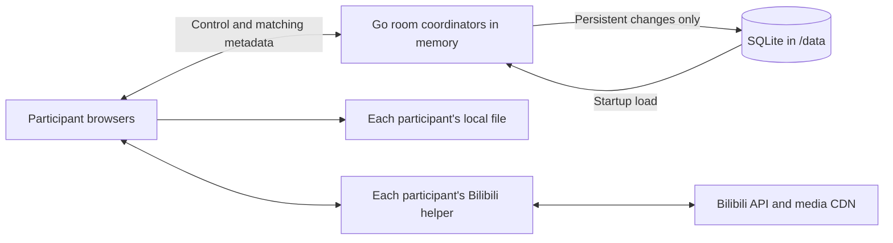

# Open Video Sync — Technical Design

## 1. Scope and requirements

The [PRD](PRD.md) defines the product. This document defines the architecture and technical contracts for the initial release.
[AGENTS.md](../AGENTS.md) defines development rules. [Application protocol](WIRE.md) defines HTTP and WebSocket messages.
Implementation status and validation evidence belong under `.misc/`, separate from these contracts.

### 1.1 Core product

OVS is a private, self-hosted tool for watching together. A participant selects media, creates a room, shares an invitation, and plays with others.
Keep anonymous persistent identities, multiple private rooms, host permissions, basic waiting, local files, and Bilibili with danmaku.
Each participant obtains media independently. OVS carries control messages and bounded matching metadata only.

Use Go, Vue 3, TypeScript, Vite, Pinia, SQLite, and WebSocket. Embed the frontend in one application container.
Keep persistent application data in `/data`. Direct HTTP works; an optional external reverse proxy owns HTTPS.
Desktop Chromium and Firefox are required. Safari is outside the roadmap; mobile support requires separate evidence.

### 1.2 Scope limits

Do not add playlists, chat, public discovery, registered accounts, account recovery, federation, horizontal replicas, or media transfer.
Do not add backup/restore commands, post-restore invalidation, online backup, automatic database repair/recovery, operational metric services, or diagnostic playback telemetry.
Browser-local statistics may be viewed or explicitly exported by the participant. Never upload these snapshots or add them to persistent stores.
Do not expose synchronization thresholds, late-join modes, per-member waiting exclusions, or retention tuning.
Invitation expiry, periodic playback checkpoints, and durable playback-command receipts are outside the product scope.
YouTube and alternative transports are outside first-release work. Keep WebSocket without a separate transport research gate.

## 2. Architecture and ownership



An optional reverse proxy sits before Go. There is no server-to-platform media path and no participant-to-participant media path.

### 2.1 Backend ownership

Organize identity, rooms, personal history, transport, contracts, storage, and process composition in separate packages.
Use small consumer-owned interfaces at actual I/O boundaries. Do not add generic caches, repositories, event buses, or empty architecture layers.

The process loads persistent identities, unexpired sessions, rooms, settings, memberships, invitations, selected-media descriptors, and personal history and recording preferences into memory before readiness.
The application owns that state for its lifetime. There is no database polling or read-through lookup on ordinary application requests.
Lists, snapshots, authorization, invitation lookup, and connected-session expiry checks read application memory.
Keep server-side expiry checks and immediate revocation; moving data into memory does not weaken authorization.

One coordinator serializes operations for each active room. Identity/session ownership has an explicit synchronized boundary.
Durable mutations commit before replacing the relevant memory state and publishing success. Publish the complete change without yielding to the next room operation.
Failed writes leave both authorization and room state unchanged. Coordinate identity revocation with socket closure before reporting success.
Do not hold a process-wide lock while waiting for SQLite. A room's management transaction may delay that room, not unrelated rooms.

Real-time commands, readiness, waiting timers, snapshots, heartbeats, and synchronization do not call storage.
Playback acknowledgement means the coordinator accepted and applied the command in memory. It does not promise survival across process restart.

Bound active rooms, connections, messages, and queues with internal defaults. Keep timer, goroutine, socket, and coordinator disposal explicit.
Inactive playback coordinators may be released. Their persistent metadata remains in application memory; reactivation starts paused at zero.

### 2.2 Frontend ownership

Vue renders views and dispatches user intent. Pinia holds sanitized room and identity state.
The synchronization engine owns clock estimation and drift correction. Adapters own video elements, files, object URLs, helper handles, and playback resources.
Do not put player instances, provider responses, files, timers, or signed URLs in serializable stores.
Cancel pending work on room, media, connection-owner, or adapter changes.

Keep the shell at the dynamic viewport height, with a bounded main region between the header and footer. The document and main structure do not scroll. Fit primary actions in the available space; use internal scrolling only for long lists, dialog content, and detail popovers. Adapt secondary headings and explanations to short screens rather than clipping controls.

Form input rows reserve space for their actions independently of input values and pending labels. Combine media parts and asynchronous feedback in one compact row. Empty feedback does not reserve a section unless the owner explicitly needs one stable line. Summaries use ellipsis and a separate native popover for full text; opening details does not change the form or dialog height. Reset details when content changes, retain status announcements and keyboard access, and isolate popover keys from form submission and playback. At a fixed viewport and language, automatic feedback must not resize or reposition form actions.

Seek previews remain browser-local and never issue playback commands or readiness changes. Coalesce pointer movement and serialize thumbnail work, retaining the last preview while loading the latest target. Local previews use a separate, lazy video decoder owned by the adapter, with cancellation and source cleanup. Wait for frame presentation before capture; a changed position or completed seek alone does not establish the decoded image. Never seek the synchronized element for a preview. Render the target frame above its time, clamp the card inside the progress bar, and keep the time visible when a thumbnail is unavailable. Do not animate pointer tracking or show a sticky touch-hover preview.

## 3. Trust boundaries and data ownership

| Data                                                                      | Browser                                 | OVS memory / SQLite                                       |
| ------------------------------------------------------------------------- | --------------------------------------- | --------------------------------------------------------- |
| Local video bytes, filename, path, file handle, object URL                | Local player only                       | Never                                                     |
| Platform cookies and login tokens                                         | Browser/manager session only            | Never                                                     |
| Signed media URLs and provider responses                                  | Helper memory only                      | Never                                                     |
| Media bytes and danmaku payloads                                          | Browser-local delivery and rendering    | Never                                                     |
| Local fingerprint, size, duration                                         | Matching metadata                       | Memory; selected descriptor may persist                   |
| Bilibili BV ID, CID, part, optional episode ID, duration                  | Matching metadata                       | Memory; selected descriptor may persist                   |
| Personal Bilibili history, titles, last-viewed time, recording preference | Current identity only                   | Persistent; bounded to 100 videos per identity            |
| Identity, display name, room settings and membership                      | Authorized views                        | Persistent; also loaded in memory                         |
| OVS session bearer token                                                  | HttpOnly cookie                         | Hash and session metadata only                            |
| Invitation link secret and code                                           | Host sharing and participant redemption | Private persistent invitation record; host-only retrieval |
| Playback position, phase, waiting, presence, command receipts             | Current room                            | Memory only                                               |
| Volume, mute, quality, danmaku preferences                                | Local preference                        | Never                                                     |

Invitation secrets are recoverable to support repeated sharing. Treat `/data` as private credential-bearing storage.
OVS session bearer tokens are stored only as hashes.
Use allowlisted DTOs. Never serialize arbitrary SDK objects, provider failures, or raw media inputs.

## 4. Anonymous identity, rooms, and invitations

### 4.1 Identity lifecycle

Bootstrap an identity automatically using a random 256-bit session token in a host-only HttpOnly `ovs_session` cookie.
Use `Path=/`, `SameSite=Lax`, and `Secure` only for configured HTTPS. Keep a rolling 365-day lifetime with renewal at most daily.
Load session hashes, expiry, identity, and CSRF metadata into memory. Check expiry there on every authenticated operation.
Create, renew, rename, and revoke through low-frequency persistent operations. Use exact-origin and session-bound CSRF checks for HTTP mutations.
Keep CSRF tokens in frontend memory. Never accept an identity ID as authentication.

Display names are optional, bounded to 48 Unicode scalar values and 192 UTF-8 bytes, and rendered as text.
There are no accounts, cross-device merging, or account recovery. Explain identity-loss consequences before forgetting a session.
Revocation immediately invalidates in-memory authorization and closes its sockets. Identity loss never transfers room ownership.

### 4.2 Room lifecycle

A persistent room contains its ID, title, host, three settings, membership, invitation, and optional selected media.
Rooms are private, with no public directory. Knowing a room ID does not authorize access.
The host changes settings, removes members, resets invitations, and closes the room. Media selection is available to the host and, when `everyoneCanSelectMedia` is true, other current members. A non-host can leave.
Membership survives short disconnects and restart. Explicit final departure closes immediately; final connection loss starts a 30-second grace. Returning connections cancel closure. Restored empty rooms have 60 seconds to reconnect after startup. Visibility changes and atomic tab replacement are not departures.

A host may leave without closing for others. Persist Everyone controls before acknowledging host departure. Keep host membership for authorized return; do not elect a host or grant management rights. Keep Everyone on return until the host deliberately changes it. A disconnected host receives the same 30-second departure grace.

Automatic or explicit closure deletes persistent records before disposing runtime resources. Failed lifecycle writes leave memory unchanged, publish a safe error to remaining connections, and disable further automatic lifecycle writes until restart. Existing playback continues.
Bound stored rooms and membership with internal resource limits. Do not turn those limits into capacity promises or a retention feature.

### 4.3 Invitations

Keep a random 128-bit link secret and an independent 16-character Crockford Base32 code.
Use `/join#invite=<secret>`; remove the fragment before loading provider components, then redeem through a JSON body. Retain the validated pending secret in the current history entry across helper installation and reloads. Clear it when joining succeeds or the page leaves the join route. Do not put it in local storage or a shared frontend store.
Normalize only documented Crockford aliases, ASCII spaces, and hyphens. Do not use short numeric room IDs as secrets.

Invitations remain valid until the host explicitly resets them or the room closes. While the room remains open, failed joins, helper installation, reloads, departure, removal, and elapsed time never invalidate them. Invitations have no expiry. The host can retrieve the same invitation again without invalidating earlier shares.
Only the host may retrieve raw invitation values. Never include them in room snapshots, lists, logs, or other participants' responses.
Store the values in the private invitation record, with indexed hashes for redemption. Do not introduce encryption-key management for this purpose.

Joining persists membership once. Redeeming again as an existing member does not duplicate membership.
Removal atomically removes membership, then disconnects the removed member. Joining, leaving, removal, and sharing do not replace the invitation; only host rotation or room closure invalidates it. A removed participant can rejoin with the current invitation. Hosts can return through the room URL or redeem the current invitation without changing membership or losing management rights.
Return one safe error for unknown, revoked, or closed-room invitations. Rate-limit redemption in memory.

### 4.4 Connections and multiple tabs

Use one playback connection per identity per room. A new authenticated connection replaces the previous connection automatically.
The previous page pauses, disposes its player, and shows that the room is open elsewhere. It does not reconnect automatically after replacement.
Reloading that page can take ownership again. Do not add a lease-management control to the normal interface.
Server-side connection identity still rejects messages from replaced sockets. Different rooms remain independent.

A disconnected member has a fixed 15-second grace in an existing wait. Remove the member from that wait after the grace.
Host departure after its separate 30-second grace sets persisted `everyoneCanControl` to true, preserving playback. The 15-second waiting grace remains independent.
Never elect or transfer a host automatically.

## 5. Room state and policies

### 5.1 Runtime room

A room runtime owns its epoch, revision, media generation, playback timeline, connections, readiness, waiting state, and bounded recent command results.
These fields are memory-only. An epoch changes on process restart or coordinator recreation; revisions and media generations are scoped to that epoch.
Persistent settings and media are loaded into the runtime from application memory, not queried from SQLite per operation.

The server owns the timeline. Participant observations cannot replace it or grant authority.
Snapshots contain the caller's room-scoped membership, sanitized roster, media, settings, playback, and current wait.
A full snapshot is sufficient for reconnect. There is no persistent event log or replay history.

### 5.2 Settings

| Setting                  | Values  | Default |
| ------------------------ | ------- | ------- |
| `everyoneCanControl`     | Boolean | `false` |
| `everyoneCanSelectMedia` | Boolean | `false` |
| `waitForAll`             | Boolean | `true`  |

`waitForAll` covers startup and sustained buffering. Synchronization thresholds and timing constants are implementation defaults, not room preferences.
`everyoneCanSelectMedia` independently permits video replacement and episode selection. Changing either permission preserves playback and takes effect immediately. Host departure expands only playback permission; it leaves video selection permission unchanged. Stored settings use wrapper version 4. Read exact version-2 and version-3 enum settings by mapping `everyone` to true and `host` to false. Version 2 defaults video selection permission to false. Do not rewrite records at startup; write version 4 on the next settings change.
All participants use the room's shared base playback rate, from 0.5 to 2 in steps of 0.25. Rate changes use the ordinary authorized playback command path. Reanchor at the current position before changing rate, preserving the phase, desired play intent, and current barrier. Keep rate in memory only; media replacement and runtime recreation reset it to 1.0. Small temporary rate corrections are automatic. Volume, mute, fullscreen, quality, and danmaku remain local.

Changing media persists only the new descriptor, then resets runtime position to zero and pauses the room.
Changing `waitForAll` cancels an existing wait and pauses the room. Changing controller permissions preserves playback.

### 5.3 Playback and waiting

Use `empty`, `paused`, `waiting`, `playing`, and `ended` phases in memory.
Play starts immediately when waiting is off. Otherwise, wait for the active playback members to load matching media and permit playback.
Freeze the required members for each wait. Late joiners never enlarge an existing wait or interrupt playback merely by joining.
Ready late joiners catch up automatically and participate in subsequent buffering waits. There is no alternative late-join mode or per-member exclusion.

Keep fixed internal defaults: 30-second wait timeout, 750-ms sustained buffering before a room pause, and one second of stable readiness before resuming.
A timeout leaves the room paused and clears automatic resume. Any controller allowed by `everyoneCanControl` can retry or pause.
Only the host changes settings or removes a member. Show who is blocking the wait without exposing policy machinery.

Use current media generation and wait ID to reject stale readiness. Never let an old load completion release a newer wait.
Manual pause cancels pending play intent. Every manual seek sets the shared target, pauses playback, clears the wait, and cancels pending play intent. Readiness arriving afterward cannot resume playback; a controller must explicitly play again. Automatic drift correction remains browser-local and preserves shared play intent.
An empty room pauses. Ended playback is derived from the server timeline; a single client's early ended event cannot end the room.

## 6. Synchronization model

### 6.1 Timeline and command ordering

Project playback from an in-memory position anchor and monotonic server time:

```text
playing: target(t) = clamp(position + (t - anchorTime) * rate, 0, duration)
otherwise: target(t) = position
```

Commands carry epoch, media generation, expected runtime revision, and command ID.
The room coordinator validates in-memory authorization and connection ownership, rejects stale intent, applies the command, then acknowledges and broadcasts.
Concurrent stale commands receive a fresh snapshot. Do not replay stale play or seek automatically.

Keep one pending command per page and preserve focused controls while awaiting its result.
Normal acknowledgement waits do not change the player layout or dim controls. Show an additional recovery overlay only when the matching result remains missing for more than three seconds.
Measure this interval from command dispatch to its matching result, independently of media loading, buffering, and readiness waits. A received result ends the interval even when media preparation continues.
The overlay never replaces the existing player status. Retrying uses the original command ID and input; a result, new epoch, terminal room connection, or page disposal clears the pending feedback.

Keep at most 256 recent accepted command results per active room for up to 60 seconds, in memory only.
Check current authorization before returning a duplicate result. Reject the same ID with changed input.
After eviction, expected revision prevents reapplying an accepted command; return stale state and reconcile instead of promising an old receipt.
A new epoch requires new user intent. Never persist command receipts or queue controls for offline replay.

### 6.2 Clock and drift correction

Use browser `performance.now()` and server monotonic time. Use a four-timestamp clock exchange and bounded low-RTT sample window.
Reset estimates on reconnect, epoch change, and resume from suspension. Track uncertainty without claiming it bounds actual playback skew.
A client may show the room while calibrating, but reports loading until it has a usable clock estimate. While seeking, report buffering when playable data is missing; otherwise report loading. Neither status is ready. During playing-state reconciliation or drift correction, sustained buffering can trigger the room's buffering wait. A manual seek leaves the room paused while data loads.
Sample player position locally every 250 ms while visible and playing. No diagnostic observation message goes to the server.

Use internal defaults: 100-ms soft drift, 750-ms hard drift, sustained-error filtering, and rate correction between 0.95 and 1.05 times the selected base rate when supported. Restore the base rate when settled, paused, or waiting, and apply it before starting playback.
Seek for large errors. Bound repeated corrective seeks and allow settling. Explicit user seeks apply immediately.
Suspend correction while buffering, seeking, missing media, or awaiting a browser gesture.
Degraded clock estimates disable small corrections while keeping explicit controls and safe reconciliation available.

### 6.3 Events and reconnect

Keep user intent separate from programmatic player events. Correlate asynchronous apply operations and cancel stale media work.
Send liveness/clock messages independently of SQLite. Pause locally after five seconds without server liveness; expire server connections after 15 seconds.
Reconnect with bounded exponential backoff, reauthenticate in memory, fetch a snapshot, recalibrate, and reconcile.
A replaced tab does not enter this reconnect loop.

After restart, persistent room metadata and selected media survive. Playback starts paused at zero with a new epoch and empty readiness.
Do not save playback position on a timer, control command, idle eviction, or shutdown. Local files still require browser reselection after reload.

## 7. Player adapter and local media

### 7.1 Adapter boundary

Use a small load/play/pause/seek/position/events/dispose boundary.
Play, pause, seek, and position reporting are mandatory. Declare optional rate and buffering capabilities without a future-provider framework.
Use seek correction without rate control at base rate 1.0. For another shared rate, pause adapters without rate control and report unsupported instead of playing at the wrong speed. If an actual adapter lacks buffering detection, explain that automatic buffering waits are unavailable for it.
Startup readiness still checks real playable state. Do not add admission exclusions or pretend an unobservable buffer state is ready.
Current local and Bilibili adapters use an OVS-owned video element; validate their actual behavior.

Handle browser autoplay denial with a local Enable playback action. Keep that participant unready until playback is permitted.
Cancel loads and remove listeners, source buffers, timers, object URLs, and helper handles on disposal.

### 7.2 Local files

Use a normal file input and an object URL. The server receives only `{kind, fingerprintVersion, digest, sizeBytes, durationMs}` and an optional user-entered label.
Do not share filenames automatically. Never upload files, thumbnails, samples, subtitles, paths, or handles.

Fingerprint encoding version 1 uses up to three 1-MiB samples at the start, middle, and end; include room ID and size in the versioned SHA-256 encoding.
The worker and shared vectors define the exact byte encoding. Use incremental hashing for ordinary HTTP.
Match size and digest, with duration within 250 ms. This detects accidental differences; it is not proof of identical content or access rights.
Probe codec support using the actual player. Do not transcode or promise untested formats.

## 8. Bilibili integration and required proof of concept

### 8.1 Selected path

Use an OVS-page-only Tampermonkey playback bridge and OVS-owned player. Do not use an iframe, platform tab, server resolver, or CORS proxy for playback. A separate launcher branch on top-level Bilibili video and bangumi pages only imports video identifiers into OVS.
Each participant installs the helper and uses their own platform access. Support ordinary on-demand video, multipart selection, and text danmaku.
Implement DASH AV1, HEVC, and AVC video with AAC audio. Require each exact codec string to pass the participant's MediaSource support check before selection. At the remembered playable quality or highest playable quality, prefer AV1, then HEVC (`hvc1` or `hev1`), then AVC (`avc1` or `avc3`). Share the video codec allowlist between helper selection and frontend metadata validation. Keep codec selection browser-local.
Validate AVC, AV1, and HEVC separately against live platform delivery. Live streams, paid episodic formats, DRM, other codecs, and mobile require separate scope and validation.

### 8.2 Helper scope and trust

Generate instance-specific rules from validated `OVS_PUBLIC_ORIGIN`. Check exact scheme, host, port, and top-level window at runtime.
Also match top-level `https://www.bilibili.com/video/*` and `/bangumi/play/*` for a lightweight launcher branch. Exit that branch before initializing the playback bridge. Share one versioned DOM menu across installed helpers and deduplicate entries by complete OVS origin. Each entry retains its installation origin and reads the current page URL on activation, including SPA changes. Transfer only a validated BV/part, EP, or SS selection through `/import#v=1&bvid=<BV>&part=<part>` or the corresponding `episodeId`/`seasonId` field with `part=1`. Do not transfer provider queries, platform responses, credentials, or room information through the Bilibili page.
During frontend development, Vite serves the local generated helper and matching release metadata for the explicit `http://127.0.0.1:5173` and `http://localhost:5173` origins. Scope each download to its exact development origin; map only those origins in the API and WebSocket proxies. Production distribution continues to use `OVS_PUBLIC_ORIGIN`.
Use narrow `@match`, `@noframes`, and reviewed `@connect` destinations. No arbitrary page-supplied URLs, headers, methods, cookies, or remote executable code.
The versioned helper has explicit missing/incompatible/permission/access errors. Distribute it with OVS and keep updates manual and reviewable.
Platform cookies stay with the browser/manager. Provider responses and signed URLs stay in helper memory.
The trusted OVS origin can invoke helper privileges; bridge nonces do not defend against malicious same-origin code. HTTP also trusts the network path.

### 8.3 Validation boundary

Validate direct browser media delivery, integrated playback, danmaku, cancellation, and independent sessions on Chromium and Firefox.
Cover HTTP, HTTPS, and ordinary LAN HTTP. Record tested browser, helper, codec, and platform-access combinations under `.misc/`.
Repeat the relevant checks when their integration contracts change.
Routine tests use fixtures. Live checks have finite deadlines and retries; blocked provider access is unverified, not a pass.

The proof of concept establishes initial integration acceptance. Carry accepted results forward into later releases, repeating only checks affected by changed integration contracts or an identified regression. A version increase alone does not require a new proof of concept.
Record acceptance in the release PR, identifying explicit user confirmation as user-confirmed validation. Detailed artifacts under `.misc/` are volatile; their absence after cleanup does not reopen accepted validation.

#### 8.3.1 Browser-local integration contracts

Use these platform interfaces and browser-local boundaries:

- Resolve BV/part/CID through `api.bilibili.com/x/web-interface/view`, tracks through `/x/player/playurl`, and danmaku through `/x/v2/dm/web/seg.so`. Allow up to 4 MiB for video metadata, which can include large collections; keep other JSON responses bounded to 1 MiB. If video metadata exceeds its response bound, abort it and fall back once to `/x/player/pagelist` for the selected BV/part, omitting the collection list. Keep the fallback within the original deadline and its 1 MiB response bound. Other failures do not trigger this fallback. Oversized optional episode lists do not block the selected video.
- Resolve canonical `/bangumi/play/ss…` and `/bangumi/play/ep…` links, or bare SS/EP identifiers, through `/pgc/view/web/season` using `season_id` or `ep_id`. Select the first main episode for a season input, never account history or an alternative accessible episode. Return the concrete BV/CID, `part:1`, and `episodeId`; persist only that descriptor. Resolve later opens, joins, quality changes, and expiry refreshes by the same EP, validating its BV mapping. Request DASH from `/pgc/player/web/playurl` with that EP/CID using the participant's own session. Keep the existing resolution deadline, JSON bounds, CDN allowlist, and browser-local media delivery. Honor platform denials and reject `is_preview` trial streams; never change region, borrow credentials, or fall back to another playback service.
- Resolve optional seek-preview indices through `/x/player/videoshot` with the selected BV/CID and `index=1`. Normalize a leading index sentinel when present, validate ordered finite times and positive safe-integer geometry, and retain image locations inside the helper. Use the returned cell dimensions, grid layout, and HTTPS image addresses under `hdslb.com` or its subdomains. Do not hardcode CDN subdomains, paths, extensions, query parameters, resolutions, or grid sizes. Reject embedded credentials and unapproved redirects. The `thumbnails` operation returns geometry, times, and an opaque source-origin group ID for each sheet; no image URLs leave the helper. The `thumbnail` operation transfers indexed sheets in chunks of at most 256 KiB, with a 4 MiB response bound per image. Deduplicate in-flight transfers by sheet and release helper bytes after the final chunk. Progressively cache every compressed sheet in adapter memory using two background workers per source group. Background bridge capacity is independent per source group and separate from the four foreground reply slots. Video initialization, pumping, and seeking do not gate or cancel unrelated CDN downloads. Retry transient metadata failures and requeue failed images with capped backoff, retaining completed sheets and allowing other origins to continue. Hover draws perform no network or bridge requests; notify the current view as sheets arrive so stationary previews update. Decode only the requested cell into a bitmap bounded by the displayed preview size. Bind work to the current player handle and generation, cancel on replacement, and release cached sheets and bitmaps on disposal. Preview failures do not change media readiness.
- Use the participant's own available session. These observed interfaces are not a maintained public playback contract.
- Load AV1/HEVC/AVC video and AAC audio through DASH with SegmentBase/SIDX and MediaSource. Bound buffering, seek work, track appends, and eviction.
- Keep signed locations inside the helper; return opaque media handles and bounded byte ranges to the page.
- Check the helper release version, protocol, and build fingerprint before opening media. Generate the fingerprint from the bundled helper source and bridge parser. Probe installed helpers without taking playback ownership so onboarding can detect an incompatible build. If the deployed build differs from the open frontend, request a page refresh first.
- On open, optionally return a browser-local playlist of up to 500 unique `{bvid,part,title,episodeId?}` entries and a title, derived from `pages`, `ugc_season.sections[].episodes`, or bangumi main/section episodes. Bangumi entries carry their concrete EP and `part:1`. Omit unsupported or oversized lists without blocking playback. Validate the bounded display metadata at the bridge boundary; never persist or broadcast playlists. The right sidebar offers Members/Episodes tabs, with the same tabs in the narrow-screen dialog. When the browser-local playlist contains more than one episode, also offer a click-operated Episodes menu in the player controls. Reuse the quality and playback-speed menu surface, positioning, scrolling, and keyboard navigation. Preserve list order and numbering, mark the selected episode, let members browse, and guard switching with `everyoneCanSelectMedia` and the existing media replacement path. Hide the player Episodes button for members without video selection permission and for single-episode or unavailable lists. Keep the sidebar list browsable with disabled episode buttons when selection is not permitted. Quick actions reuse that local playlist: `@` lists episodes, a numeric argument matches the original one-based list position exactly, and other arguments match all case-insensitive title keywords. Preserve original order and numbering. A Switch episode action fills `@` without closing the panel. Members without video selection permission can browse but cannot execute selection. Mark the selected BV/part/EP. Keep keyboard navigation and filtering immediate, ignore IME composition Enter, and clear the search context when leaving the room or changing to an unrelated playlist. The host or a member allowed by `everyoneCanSelectMedia` selects an episode through the existing media replacement path; send the resolved selected-media descriptor with `autoPlay:true`. Quick actions show selection progress, prevent duplicate execution, close after the matching successful server command result, and retain the query and safe error on failure. Closing the panel does not retract a submitted command. After persistence succeeds, atomically advance media generation and start playback from zero through the ordinary play/wait policy. Clear old readiness and reject late reports. Other media replacements default to paused at zero; restart never retains automatic play intent. Keep selection immediate and cancel stale adapter work.
- Permit only reviewed HTTPS API/CDN hosts and paths, including the selected `bilivideo.com` destinations and `upos-hz-mirrorakam.akamaized.net`. Reject unapproved redirects.
- Retain at most three distinct permitted locations from each DASH track's primary and backup URLs in helper memory. Start with the first permitted location. Skip unsupported locations without requesting them. If no location is permitted, report media-address incompatibility separately from network or helper-permission failures.
- Try permitted mirrors after network failures, timeouts, HTTP 403/410, 404/408, or 5xx. Try unused mirrors after two substantial reads that cannot sustain the selected representation's byte rate with headroom. Do not switch on cancellation, denied redirects, oversized responses, or HTTP 429. Use actual media reads rather than separate speed probes. Before continuing an existing byte cursor on another location, compare its initialization and SIDX bytes with the bytes already delivered. Exclude locations with mismatched bytes until expiry refresh. Keep the working source when a slow-source replacement has no usable mirror. Try each location at most once per byte operation; later operations can reuse recovered locations. Do not fabricate locations.
- Bound request/response size, concurrency, and deadlines. Keep two active helper requests per source origin; do not combine CDN capacity into a global download limit or cancel requests because another origin is active. Each byte operation, including mirror attempts and at most one location refresh, shares a 12-second deadline. Allow an initial mirror attempt up to four seconds while untried alternatives remain in that operation. Keep separate bounds of 128 byte calls and 32 other bridge messages per second for local dispatch protection; these message bounds do not pool network download capacity. Cancellation remains available when those bounds are reached.
- Preview and open share a 24-second helper resolution budget across their sequential view and playurl requests, including the optional single-video fallback request. Allow at most 12 seconds per network request and 30 seconds for their bridge replies. Other bridge operations retain a 15-second deadline; expiry resolution within a byte operation uses that operation's remaining 12-second budget.
- Keep no provider payloads or credentials in helper storage, frontend persistence, logs, SQLite, or room messages.

Report tested versions and limitations when validating changes. A passing browser/codec combination does not establish support for every platform access mode.

### 8.4 Playback and danmaku

The host supplies a canonical BV URL/ID and part. Each participant independently resolves the same `{bvid,cid,part,durationMs}`.
Require exact identifiers and duration within 250 ms. Access failure affects that participant only.
Media comes directly from the platform through the browser-local helper. Never download a whole video before playback or persist media.
Refresh expired locations locally with bounded retries and current-generation checks. Pin the existing video and audio quality IDs and exact codecs during refresh. Fail with media changed if either representation disappears; never append a different encoding using the existing byte index.
Browsers can defer opening a new MediaSource in a background tab. Count only visible time toward the source-open deadline, and continue initialization if the source opens while hidden. Preserve immediate cancellation and media-error handling. Bound helper operations and SourceBuffer updates independently.

Render bounded scrolling, top, and bottom text comments against observed video time. Follow pause, seek, rate correction, and part changes.
Reuse loaded comments and pending requests when a seek stays within the current six-minute comment segment, including position corrections after pausing. Rebuild visible comments at the observed time without clearing segment data. On a seek across segments, clear the previous segment and ignore its late replies. Keep explicit comment reload available.
Visibility, density, text size, scrolling speed, and display area are browser-local preferences that persist across reloads and rooms. Offer 0.5×–1.5× comment speed independently of shared playback speed.
Keep each visible comment in its assigned lane. Use measured text width, font-sized rows, and predicted exit positions to prevent overlap, including faster comments catching slower comments. Share occupied rows with pinned comments only after those rows clear. Offer full screen, the top half (default), or the top quarter of the player as the comment area. Limit only scrolling comments to the selected area. Fixed top and bottom comments use the full overlay, with their current positions and remaining lifetimes preserved when the area changes. Reserve the bottom controls area. Consume crowded timestamps once instead of displaying skipped comments late.
At 1×, every scrolling comment takes ten seconds from entry until its tail exits. Calculate velocity as `(viewport width + measured text width) / 10`, so longer comments move faster while sharing the same traversal time. Apply the local speed multiplier to velocity; an unchanged setting takes `10 / speed` seconds. Apply speed changes from the current position. Drive only transforms from observed media time, so pause and synchronization rate corrections also apply to comments. Pinned and reduced-motion comments remain stationary for six seconds. Rebuild layout after seeking, resizing, or changing text size, and dispose rendering with its adapter.
Ignore executable/advanced-script comments. No submission, server persistence, or relay.
Comment failure is distinct from playback failure and from hiding comments.

The helper returns playable quality IDs from the participant's DASH response and accepts a requested ID on `open`.
Show the loaded track's AV1, HEVC, or AVC codec beside the Bilibili source label. Derive the badge from browser-local adapter metadata, clear it during media replacement, and update it after quality changes. Keep the badge absent for local files and unknown metadata.
SIDX parsing accepts the full 31-bit direct-reference size without allocating a whole media fragment. Nested indexes and unsafe offsets remain invalid.
Transfer and append at most 256 KiB at a time. The page supplies the current SIDX fragment's final byte and byte rate for bounded helper read-ahead. Target two seconds of media per remote Range request, round up to a 256 KiB boundary, and cap each window at 2 MiB and the fragment boundary. Alignment prevents downloading an unused window tail again. After a timeout, halve the read-ahead cap down to 256 KiB while retaining at least the requested bytes. Preserve the reduced cap across retries and location refresh. After two consecutive full network windows each complete within one quarter of their request timeout, double the cap toward 2 MiB. Keep one current network window, at most one following window, and bounded initialization/index copies per track in helper memory. Download the following contiguous window while the page consumes the current window, without crossing the current fragment's final byte. Settle speculative failures and retry on demand within that byte operation's deadline. Measure actual request duration independently of how long prefetched bytes wait for consumption. Seeking, disposal, and location replacement invalidate old windows and cancel owned requests. Check the exact Content-Range and response length. Keep signed locations out of page messages.
Initialize audio and video concurrently, creating both SourceBuffers before either initialization append. Keep each track's initialization and index reads sequential. Keep one cursor, one current chunk, and at most one read-ahead chunk per track. Overlap the next read with the current append. Run independent audio/video workers with at most four chunks per track per buffering pass, so a slow video read does not hold audio reads or writes. Join both workers before handling failures or starting another pass. Yield between passes; continue immediately while making progress, and poll at 250 ms when buffered or quota-blocked. Retry transient helper congestion for media and danmaku within finite bounds. For media reads, also retry network failures, request timeouts, HTTP 408, and 5xx at the same byte cursor up to three times, after 250, 500, and 1000 ms. Preserve the player and appended data during retries. Seeking and disposal invalidate retries before further requests or appends.
Track completed fragments within each seek generation. Advance even when reordered frames need the next fragment to complete the reported buffered range. A later seek can download evicted fragments again.
Use nearby SIDX byte rates to estimate a 64 MiB video / 8 MiB audio buffering budget. Reserve a small share for up to four seconds of history and use the rest for forward buffering. Use a three-second startup target, then a 30-second steady-state target that grows with observed read delays up to 60 seconds. Clamp the target to 1–60 seconds under the byte budget. Preserve the selected quality and representation while building this reserve; network speed never triggers a quality downgrade. Decay old delay peaks rather than resetting the target on fast cache hits. Preserve the current fragment's keyframe during eviction. Choose the removal boundary within the preceding fragment rather than at the current SIDX timestamp: index rounding can place that timestamp after the actual keyframe, and native removal also drops dependent frames through the next random access point. Retain decoder dependencies even when they extend the history target. These estimates do not measure browser allocations.
On browser quota pressure, evict played data and retry the same chunk once. Retain that chunk while buffered playback can advance; fail if no playable headroom remains.
On seek, advance a browser-local seek generation, immediately cancel obsolete media reads and expiry refreshes, clear helper read-ahead windows, discard stale replies, and reset incomplete MediaSource parsers before reading a new fragment. Reopen an ended MediaSource in segments mode before aborting an abandoned parser. Keep current-segment danmaku requests alive. Browser codec and memory limits still apply.
Only returned tracks are offered. Quality switching opens a new local adapter, retains room playback intent, reports readiness, and converges to the current timeline.
Never claim a pending/failed quality is active. No adaptive Auto mode is implemented. Validate live quality switching independently from fixed-quality playback.
Root `versions.toml` is the sole module release-version source. The helper build generates `modules/helper/dist/release.json`; script identity is stable per instance. `probe` is non-owning and never cancels active helper work.

### 8.5 Browser-local playback statistics

Expose typed, optional adapter statistics without putting player objects or samples in Pinia. Read resolution and forward playable buffer from the current video element. Count only the buffered range containing the playhead. Prefer validated selected-track metadata for frame rate and bitrates; label sampled frame rates as estimates and omit unknown values. Use the current playhead and each track's SIDX index for current/total segment counts.

Measure aggregate audio/video response bytes at the helper's actual network requests, scoped to the current media handle. Count delivered response bytes once, including observed partial transfers and retries. Do not count bytes again when serving helper read-ahead data. Exclude metadata, danmaku, and thumbnails. Publish bounded numeric snapshots through the browser-local bridge without source addresses or arbitrary provider payloads. Statistics requests must respect current client, handle, and generation ownership. Sampling failures must not change playback readiness.

Poll adapter statistics sequentially about once per second while the overlay is open and visible. Keep at most 30 recent throughput samples. Stop polling on close and disposal, and ignore late snapshots after media or adapter replacement. Copy/download actions serialize only the displayed numeric statistics and validated component versions. Keep snapshots out of room messages, server logs, SQLite, and browser persistence. Provide a selectable-text clipboard fallback on ordinary HTTP.

## 9. HTTP and WebSocket contracts

[Application protocol](WIRE.md) defines HTTP routes and socket envelopes with protocol identifier 1. Helper protocol and local fingerprint encoding each use identifier 1.
Version application routes and socket envelopes together; serve the matching frontend in the same binary.
Use one room engine and reject unsupported settings fields.
An incompatible client receives an upgrade error and reload guidance without processing its mutation.

Keep session/profile, room creation/listing, invitation retrieval/reset/redemption, settings, removal/leave, closure, and the room socket.
Real-time socket messages cover controls, media selection, readiness, snapshots, command results, lifecycle, clock, and heartbeat.
Use bounded strict decoding, safe errors, and connection sequence checks. Reject unsupported message types.

Keep short-lived HTTP retry results in bounded application memory. No HTTP idempotency table is required.
Existing-member redemption is naturally idempotent. On restart or an expired create receipt, GET the known random creation ID and require fresh intent if unavailable. Never retry creation blindly or rely on a room list.
A reused in-memory request ID with changed input is rejected. Never promise recovery of a command outcome across restart.

## 10. SQLite persistence

### 10.1 Persistent data

| Record             | Persisted information                                    | Write trigger                                                 |
| ------------------ | -------------------------------------------------------- | ------------------------------------------------------------- |
| Schema release     | SQLite `user_version`                                    | Creation or successful deployment migration batch             |
| Migration ledger   | Independent migration ID, checksum, completion time      | Creation or deployment migration                              |
| Identities         | ID, optional display name                                | Create or rename                                              |
| Sessions           | Token hash, identity, CSRF metadata, expiry              | Create, daily renewal if needed, revoke                       |
| Rooms              | ID, title, host, three settings                          | Create, change settings, close                                |
| Members            | Room, identity, room-scoped member ID                    | Join, leave, remove                                           |
| Invitations        | Current link/code values and indexed verification hashes | Create or explicit host reset                                 |
| Selected media     | Allowlisted local or Bilibili descriptor                 | Select or replace media                                       |
| Viewing history    | Stable Bilibili identifiers, titles, last-viewed time    | First actual playback in a viewing session; explicit deletion |
| History preference | Whether to record personal viewing history               | Explicit preference change                                    |

SQLite is not a runtime state store, queue, authorization polling mechanism, or synchronization clock.
Do not persist playback checkpoints, command results, HTTP retry receipts, storage probes, connection state, runtime revisions, or media generations.
Only personal history records a last-viewed timestamp when actual playback first begins for a video in a viewing session. Do not update it for playback samples, pauses, buffering, quality changes, heartbeats, or snapshots.
Session expiry remains enforced; expired sessions may be removed on startup and low-frequency credential maintenance.
Only empty-room departure cleanup is automatic; do not add invitation/identity retention policies.

### 10.2 Reads, writes, and failure

Read persistent application state on startup. Keep all hot-path reads and writes in memory afterward.
Durable user actions use short transactions that update only the affected records. Never rewrite room members or invitations for a playback action.
Keep constraints and foreign keys. Serialize persistent writes through one worker with a queue of at most 128 pending transactions.
There is no periodic flush of runtime state and no write-behind durability promise.

A failed persistent operation reports failure and leaves memory unchanged. Existing playback and in-memory permissions remain usable.
Mark persistent writes unavailable after an operational database failure. Do not run write probes or automatic recovery transitions.
The operator fixes storage and restarts OVS. Startup must load valid state successfully before readiness.
A failed revocation must report failure; it must never appear successful while leaving a reusable durable credential.

### 10.3 Startup and schema initialization

Acquire the data-directory lock before opening SQLite. Only one process owns a data directory.
Use WAL, foreign keys, a five-second busy timeout, and `synchronous=FULL` for persistent transactions.
`modules/sync/sql/schema.sql` always defines the complete, current database schema. Update that definition whenever the schema changes.
Create an empty database from that definition in one transaction, record the supported schema version in SQLite `user_version`, and register included migrations in `schema_migrations`. Do not execute historical migration SQL for a new database.
Reopen a current database after validating its schema release version and complete expected ledger, without rerunning DDL or rewriting the ledger. Application startup must not migrate existing databases. An older supported schema or incomplete known ledger prefix returns deployment-migration guidance. Reject future schema versions, unknown or inconsistent ledger entries, and nonempty unversioned databases without altering application data.
Numbered SQL files in `modules/sync/sql/migrations/` are immutable deployment migrations; keep Go embedding code in `modules/sync/sql/`. Each ledger row records its independent `migration_id`, SQL checksum, and completion time. Migration IDs are an ordered sequence independent of the release-level schema version: one release can contain multiple migrations. The pending set depends on the applied ledger prefix, including when `user_version` already matches the target release.
The separate `ovs migrate` command requires only `OVS_DATA_DIR` (default `/data`) and takes the same exclusive directory lock. It starts no application services. Deployment stops old OVS, runs this command from the verified candidate image, and starts the replacement only after success. Ordinary startup, health checks, and restart never invoke it.
Existing schema-v1 databases have no ledger. Recognize that supported baseline and create the ledger infrastructure before executing feature migration SQL. Migration ID 1 adds viewing history for schema release 2; the two numbers have no required relationship. Validate the applied ledger prefix and recorded checksums before executing the pending IDs in order. Apply the whole pending batch and ledger updates in one transaction, and set `user_version` to the target release version only after all migrations succeed. A failure rolls back the batch and stops deployment; retry requires fixing the cause. Do not downgrade automatically.
Never reset a database to hide schema errors. Restart always begins paused at zero.

### 10.4 Data directory

Keep `/data` across container replacement. If an operator copies data, stop OVS and copy the whole directory with ownership, modes, and SQLite sidecars.
Do not copy a live database file alone. Old copies represent old application state, including old credentials.
OVS supplies no backup/restore or invalidation CLI and no automated downgrade workflow. Use a binary compatible with the saved schema.

### 10.5 Personal viewing history

Each anonymous identity owns at most 100 Bilibili history entries and an enabled-by-default recording preference. Store only stable BV/CID/part and optional EP identifiers, bounded titles and episode names, and server-generated last-viewed times. Never retain room IDs, memberships, playback progress, raw links, provider objects, or credentials in history. Deduplicate by EP when present, otherwise BV plus part, and move repeated views to the front. Upsert and trim the oldest excess entries in one transaction.

Expose authenticated `GET` and `POST /api/v1/me/history`, `DELETE /api/v1/me/history/{entryId}`, `DELETE /api/v1/me/history`, and `PATCH /api/v1/me/history/preferences`. Use existing origin, CSRF, size, and strict JSON boundaries. Derive ownership from the session; do not accept a target identity. Reads use memory. Mutations commit before updating memory and returning the current list and preference. History failure must not interrupt shared playback.

The frontend records once only when the current connected owner observes matching Bilibili media actually playing while the shared phase is playing. Autoplay probes, preview, waiting, gesture denial, and local files do not qualify. Suppress repeats across pause/resume, buffering, correction, and quality reloads. Deleting the current entry must not make the ongoing sample loop recreate it. Cancel or ignore obsolete identity and media work, and clear client caches after identity changes.

Home selection, video replacement, and the global history Quick action share a searchable history list. Selecting an entry prefills the exact episode for fresh resolution through that participant's platform access. Home creation and room replacement remain explicit confirmation steps. All members can browse and manage their own history; only members with media-selection permission may replace the room video. Mark the current video and preserve its position when selected again. Closing a room does not remove personal history. Losing an identity makes its history inaccessible to a newly created identity.

## 11. Security and resource limits

Enforce membership, host policy, current connection, epoch, media generation, and revision in the server's memory-owned state.
Use high-entropy credentials, HttpOnly cookies, exact Origin/Host checks, CSRF protection, safe text rendering, CSP, and bounded strict JSON decoding.
Do not expose platform credentials, invitation secrets, session tokens, or raw provider failures in logs or diagnostics.
Use the configured public origin for links, cookies, and helper scope. Trust forwarding headers only from explicitly configured proxy peers.

Bound frames, room members, sockets, queues, request rates, and slow-client deadlines with internal defaults.
Drop slow clients and resynchronize instead of blocking a room. Never silently drop command results.
No administrator-facing tuning dashboard or metrics endpoint is required.

## 12. User experience, packaging, and operations

### Bilibili video imports

Consume and scrub import fragments before mounting provider components. Strictly validate the bounded versioned selection, reject duplicate or unknown fields, and retain validated input only in the current history entry across helper installation and reload. Clear pending input after success or departure. Opening or reloading an import link performs no room mutation.

Preview through the existing browser-local helper. List the caller's rooms through HTTP and fetch the selected snapshot without connecting a room socket. Permit replacement only for the host or when that snapshot grants `everyoneCanSelectMedia:true`. Show the new video and target room before explicit replacement confirmation. Create rooms through the existing idempotent creation path with host controls and waiting enabled.

After confirmation, discover the active same-origin tab with video selection permission through `BroadcastChannel`. Use a versioned, strictly decoded message shape with bounded pending requests and in-memory receipts. Target its tab ID, room ID, epoch, media generation, and revision; submit through that tab's existing `media.select` socket path with the import request ID as command ID. The socket and server remain the authorization boundary. Only the matching server command result confirms success. Preserve the original envelope for uncertain retries, including after reconnect, and never reinterpret a timeout as permission to submit a fresh command or take over another tab. Reject changed room state and require refreshed confirmation. Release channels, listeners, and timers on disposal.

If discovery has no response or cross-tab messaging is unavailable, explain connection takeover and offer explicit opening in the import tab. Recheck the confirmed snapshot before opening, then use the same guarded selection path after the room connection is ready. Keep this fallback usable on ordinary HTTP. A replacement persists the selected descriptor and starts everyone paused at zero through the existing media-generation and readiness reset.

### Player context menu and statistics overlay

Right-clicking the video surface opens a player-owned context menu. ContextMenu and Shift+F10 offer the same menu from player focus. Preserve native context menus on controls, editable elements, and overlays. Clamp the menu inside the player and viewport, support arrow/Home/End navigation, and close on Escape or outside input without toggling playback. Bilibili items open the canonical BV/part or EP page in a new tab, toggle local danmaku, or reload danmaku. Keep the reload action out of the danmaku preferences panel. Do not offer a copy-video-link action.

Both local and Bilibili media offer Video statistics and Keyboard shortcuts. Add the same actions to Quick actions. Keep statistics as a compact, dark, translucent nonmodal overlay at the player's upper-left corner; constrain it to the available player area and scroll its contents when needed. Opening statistics does not pause playback or pin the control bar. Ordinary player shortcuts continue outside the overlay's interactive controls. Clicking inside the overlay does not toggle playback. Its close button and Escape dismiss it before fullscreen exit when browser keyboard handling permits. Show available resolution, frame rate, audio/video bitrates and codecs, per-track segment positions, forward buffer, aggregate download activity, and component versions. Do not show MIME type, player type, hosts, dropped frames, or per-track speed fields. Update values and the network graph without decorative animation. Shortcut help isolates keys like other player dialogs.

### Application interface

The main journey is select media on home, create or automatically redeem an invitation, share, and watch.
Home has inline Bilibili/local selection and invitation input, with no room directory. Room management uses accessible dialogs. The dark player integrates seeking, replay, volume, mute, fullscreen, danmaku, real playable quality selection, and shared playback speed from 0.5× to 2×.
Show the seek preview time above the pointer position and keep the tooltip within the track at either edge. Update immediately on pointer movement and hide on pointer exit.
Retain the creator's browser-local file through the in-app transition. Automatically load Bilibili on entry and media changes; local participants choose their own matching file. Helper onboarding uses a non-owning probe, a bottom toast, and a dismissible entry dialog. Installation offers Reload page because userscripts activate on document startup. Use the instance-bundled helper release metadata as the version source. Detect a changed deployed helper requirement before recommending installation. Show names, connection state, readiness, and available controls.
Video-surface clicks and Space/K use the same authorized shared playback commands. Listen for player shortcuts across the foreground OVS page without requiring player focus. Left/Right seeks; Up/Down changes volume in bounded 10% steps and immediately shows local volume from 0 to 100 without a percent sign over the video for 1.2 seconds, renewing that interval on each press; M toggles mute, D toggles Bilibili danmaku, S toggles browser-window fullscreen, and F toggles native fullscreen. Interactive inputs, menus, and dialogs retain native key behavior, including Space activation on their buttons. Outside these surfaces, prevent native Space activation and toggle playback without moving focus, including on ordinary page buttons and links; Enter keeps native button activation. Ignore composing, modified, or already handled shortcut events. Backgrounding does not pause playback or disable synchronization while the connection remains active. On return, request fresh clock samples without clearing a usable estimate or interrupting playback. Persist only validated volume, mute, quality, and danmaku visibility, density, text size, scrolling speed, and display area values in browser-local storage, with unmuted 50% volume and half-screen danmaku as the defaults. Quality has a dedicated keyboard-accessible menu. The helper selects the remembered playable tier or the highest returned playable tier when absent/unavailable. The player has no separate settings button. Use separate click-operated icon buttons for danmaku visibility and settings. The settings icon combines the danmaku visibility chat icon with a gear badge. Give the four right-side icon controls equal painted width, height, and centers, including the gear and alternate visibility/window-mode states. Clicking the visibility button or pressing D toggles comments without opening preferences. Clicking settings toggles its density, text size, scrolling speed, and display area panel; Down also opens it and focuses its first slider. Escape and the close button restore focus to the settings button. Do not open settings on hover or long press. Omit the status footer. Keep the panel open while interacting with its controls; close on outside input and resize. Own and dispose listeners with the control component. Local videos show no danmaku controls. Change video uses form submission for Enter confirmation, excluding composing Enter. Confirm room departure before mutation. The OVS logo is a button using the same departure confirmation and mutation as Leave, then returns home in the current tab. Cancel preserves the room and restores focus to the initiating control. Use the OVS play mark as the browser tab icon. Include an accessible GitHub Star link with its current count in the header, including narrow screens. Fetch the fixed public GitHub repository endpoint once per page without credentials or a referrer, validate a nonnegative safe-integer `stargazers_count`, and cancel after five seconds or on disposal. Show an em dash while loading or unavailable; never substitute zero for an unavailable count. Keep the link usable on failure. Allow only that endpoint in the production `connect-src` policy. Treat the main region as the available sizing budget, with no fixed room-width cap. Scale the video uniformly until either the available width or height is reached. Center the room and make its card exactly as wide as the fitted video plus any visible member pane and borders. Align the room toolbar, video metadata, and status with that card. Leave unused space outside the card. Measure the toolbar, player details, and borders rather than assigning a fixed height budget; recompute when the viewport, source dimensions, member pane, or measured content changes. Own and dispose layout observers and scheduled measurements with their views. Let room content end naturally when width constrains the source before the available height is used. Size the player from native videoWidth/videoHeight on metadata and dimension changes, using 16:9 until dimensions are known and resetting that fallback when media is cleared. Fit the full source within both the available column width and the height left after the toolbar, metadata, status, borders, and page gutters. Keep the player surface at the source aspect ratio without cropping, stretching, or adding black bars; bars encoded into the source remain part of the video. Keep the video surface at the full width of its viewing column. Keep native video dimensions out of layout sizing by positioning the video inside its explicitly bounded surface. Give the player panel an explicitly shrinkable grid column and let its details grid item shrink. Ellipsize long titles inside that column so metadata cannot enlarge the player, shift its center, or overlap the member pane. Adapt the room toolbar to the fitted card width and playback controls to the fitted video width. Keep player controls reachable on desktop and mobile. Long member and episode panes scroll locally. Preserve viewport-filling fullscreen behavior.
Player controls appear on pointer entry, movement, focus, and Tab navigation. Restoring the browser window's existing focus preserves controls visibility; modified Tab shortcuts, including Alt+Tab, do not reveal controls. Player shortcuts preserve the current controls visibility, including when playback state changes after acknowledgement; the numeric volume overlay remains independent. Hide after three seconds without activity while playing; while paused, keep controls visible inside the player. Pointer exit hides controls immediately in either state. Control-bar hover, an open quality, playback-speed, episode, or danmaku menu, and seek dragging hold controls visible; when the interaction ends, hide immediately if the pointer is outside or restart the playing idle timer inside. Passive focus in the player must not prevent automatic hiding. Preserve native focus, keyboard access, and timer/listener cleanup.
Browser-window fullscreen fills the browser content area while preserving browser chrome. Provide a player-control toggle, an S shortcut, shortcut help, and a Quick action. Keep this mode local and transient, preserve the live video element and playback, and adapt controls to the available viewport. S toggles the mode without responding to held-key repeats. Escape dismisses the top overlay or statistics first, then native fullscreen, then browser-window fullscreen, including from a focused player input. Native fullscreen temporarily covers the window mode and restores it on exit. S from native fullscreen returns directly to browser-window fullscreen. Keep these transitions immediate.
The host sees three Boolean checkboxes: Allow everyone to control playback, Allow everyone to change videos and episodes, and Wait for everyone. The first two default unchecked; waiting defaults checked. The host also sees sharing/reset, remove-member, and close-room actions. Keep engineering parameters out of the UI.
Use Vue I18n for English and Simplified Chinese across interface text, accessibility labels, page metadata, and safe public failures. Follow the first browser language by default: Chinese language tags select Simplified Chinese; other tags fall back to English. React to system language changes while following the system. Offer System, 简体中文, and English through Settings → Language. Persist only the allowlisted language preference in browser-local storage, independently of identity, rooms, and appearance. Blocked storage keeps in-page switching usable. Store message keys and named parameters for transient messages so existing notices change language immediately. Keep participant content and media metadata in their original language.
Show actionable errors such as Choose the same file, Enable playback, Waiting for a participant, and Platform access unavailable.
Keep keyboard operation, subtle color feedback for focused controls, text labels, responsive layouts, and reduced-motion support. Suppress focus outlines on all focus targets and focus-containing wrappers. Preserve actual focus and focus restoration; do not blur controls to remove focus styling. While playback commands await confirmation, keep buttons and seeking focused with guarded, aria-disabled controls instead of native disabling; repeat actions remain unavailable.
The top open dialog or menu owns keydown, keypress, and keyup events even when focus remains underneath. Preserve native editing, navigation, and activation inside the surface; consume Escape to dismiss only that surface and restore focus. Keep a closing key's repeats and release isolated after unmount or transfer to another overlay. Request fullscreen keyboard locking and Chromium's Escape-only keyboard lock when available, releasing owned locks on fullscreen exit and player disposal. With locking allowed, the first Escape dismisses the overlay while fullscreen remains active; the next Escape exits fullscreen even from a focused player input. Browser-owned exits remain possible when locking is denied or unavailable, including Chromium on ordinary HTTP; dismiss the top overlay when fullscreen exits rather than leaving it open. Do not require HTTPS or keyboard-lock permission for playback or fullscreen entry.
Quick actions open through Cmd/Ctrl + K or a header entry beside the brand. Match localized labels, English/Chinese aliases, and `/` commands entirely in browser memory. `$` and direct canonical Bilibili links/BV/SS/EP identifiers use the existing picker parser; pass only the parsed identifier and part to the picker, then require the normal preview/confirmation flow. Never resolve provider data or publish media while searching. Offer only context-appropriate actions, retain disabled playback reasons, and reuse the existing player and room authorization paths. Keep search input focused while using arrows, ignore composing Enter events, close instantly, and restore focus before opening a destination. Do not persist search text or add a room directory.
Keep server status, settings, and user identity on the right of the header. The settings menu groups appearance, language, notifications, and About, with native outside-click and Escape dismissal, keyboard navigation, and focus restoration. About reads the uncached public `GET /api/v1/version` response (`sync`, `web`, `helper`, `image`, `release`, `commit`, `dirty`, `tag`). The service uses its linked build version; frontend and helper versions come from their embedded release metadata. Capture the full image reference, release classification, full Git commit, dirty state (including untracked source files), and exact current-commit tag during the frontend build and embed them in the application. Classify a build as a release only when the checked-out branch is `main` and a valid `vYYYY-MM-DD` tag points directly at `HEAD`, using the same selection as image naming. An explicit `IMAGE` override changes the displayed image reference without changing this classification. Container builds receive the same snapshot from the source checkout. Runtime metadata never depends on Git or the deployment directory. About places the full image reference and shared build-information heading in its header, above a separate list of component versions. Only development builds show a 12-character commit with the full hash in its title and a dirty badge for modified source. Do not display a separate Git tag. Without Git metadata, use an empty commit/tag, `dirty: false`, and `release: false`; retain the supplied image reference or default to `ovs:dev`, and hide the commit. Never use the browser-installed helper version for About.
Appearance is browser-local: use a muted Slate blue default, selectable Soft iris, Graphite, Quiet teal, Sage green, Dusty rose, Warm amber, Ocean blue, and Soft clay accents, and manual light/dark modes with dark as the default. Ignore system theme changes; unsupported mode preferences fall back to dark. Persist only the allowlisted mode and accent in local storage; storage failure leaves in-page switching usable. Apply saved appearance before the first styled paint with a same-origin, revalidated bootstrap. Keep the video surface dark in either mode. Dialog motion uses opacity and scale, with a brief opacity-only reduced-motion path; keyboard interaction stays immediate.

Application messages and helper reminders use dismissible fixed bottom toasts without changing layout height. Persist an allowlisted left/center/right position in browser-local storage, defaulting to right. Success messages expire after six seconds, pausing while hovered or focused. Errors and helper reminders remain until dismissed or resolved.

Build the frontend before Go embedding. Ship one non-root application container with writable `/data`, without Node or an external database.
Local image builds and SSH deployment use `ovs:vYYYY-MM-DD` when the checked-out branch is `main` and a valid release tag points directly at `HEAD`. Otherwise, use `ovs:dev`. Accept only valid calendar dates, select the newest date if several release tags match, and preserve explicit `IMAGE` overrides.
Configure the process with `OVS_LISTEN_ADDR`, `OVS_DATA_DIR`, `OVS_PUBLIC_ORIGIN`, and `OVS_LOG_LEVEL`. Optional trusted-proxy CIDRs (`OVS_TRUSTED_PROXIES`) affect only proxy address handling.
Use internal room/socket limits. Do not expose retention, synchronization, or recovery settings.

Keep direct HTTP and concise host/container/existing Caddy examples. OVS does not manage certificates or alter an operator's proxy installation.
The deployment tooling may provision a separate Caddy container over SSH. It builds and transfers images locally, prepares Compose when absent, and keeps persistent volumes stable across single-instance replacements. After preparing and validating the candidate, it stops OVS, runs the candidate's database migration command without network access, and starts the replacement after migration succeeds. Public IP HTTPS uses explicitly configured short-lived ACME certificates. Public TLS verification must not fall back to internal certificates. Existing proxy installations require explicit external mode and remain operator-owned. Failed preparation leaves the running application intact; migration or startup failures preserve data without an automatic downgrade.
Use bounded shutdown to stop admission and close sockets, workers, and SQLite. There is no playback checkpoint to save.
Keep structured error logs and minimal liveness/readiness checks using in-memory startup, shutdown, and write-failure flags, without SQLite polling.
Readiness may report failed persistence without stopping an already running playback loop.
Do not add metric collection, backup operators, or automatic database repair.

## 13. Validation

Validate core behavior on desktop Chromium and Firefox, including one mixed-browser room and ordinary LAN HTTP.
Keep unit/integration coverage for authorization, stale commands, waiting, cancellation, isolation, schema initialization, and failed durable writes.
Verify actual player behavior in browsers: local selection, codecs, autoplay, play/pause/seek, buffering, reconnect, tab replacement, Bilibili, and danmaku.
Use a representative external HTTPS proxy journey and verify WebSocket reconnect. Reuse the same application checks across equivalent Caddy arrangements.

Prove the persistence boundary after initialization: ordinary reads, playback controls, readiness, and timer ticks perform zero SQL operations.
Exercise real SQLite for schema initialization, rollback, constraints, and durable changes. After restart, identities/rooms/settings/members/media survive; position, waits, and receipts do not.
Test a failed settings/member transaction without corrupting memory, and verify existing playback can continue without database access.

Measure control-response latency separately from actual playback skew. Use decoded-frame observations and declare their uncertainty and limits.
Exercise representative cross-region latency, jitter, packet loss, asymmetric paths, and recovery. Record conditions and observed results.
Carry accepted network validation forward in the release PR. Repeat the affected checks when synchronization or network contracts change or a regression is identified; a version increase or deletion of volatile `.misc/` artifacts alone does not reopen acceptance.
There is no fixed 20-room capacity gate, mandatory physical-display lab, universal p95/p99 SLA, or statistical-significance gate for ordinary releases.
For a performance claim, compare repeated trials in a matched environment and state sample counts and limitations. Do not infer faster playback from fewer SQL calls alone.

Routine tests stay offline. Live Bilibili checks remain explicit and bounded; missing live validation remains unverified.
Follow the regression-first ladder in AGENTS.md. Keep relevant evidence under `.misc/` and do not claim hosted CI success from local checks.
